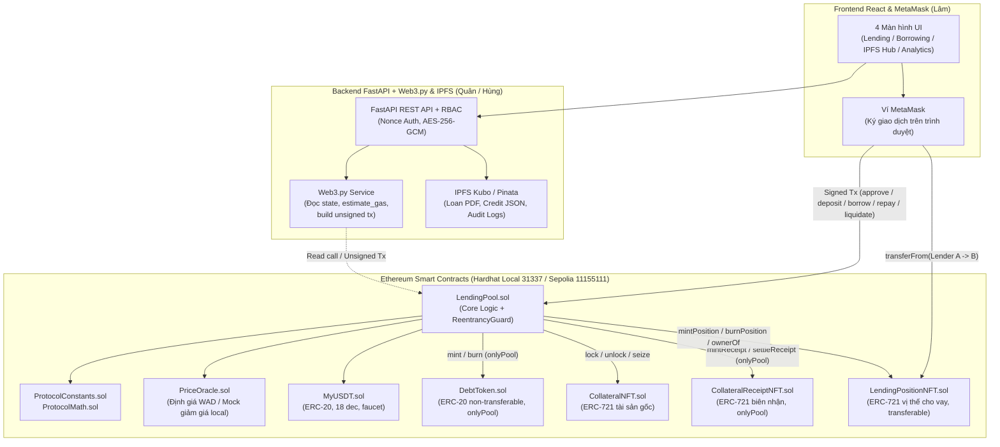
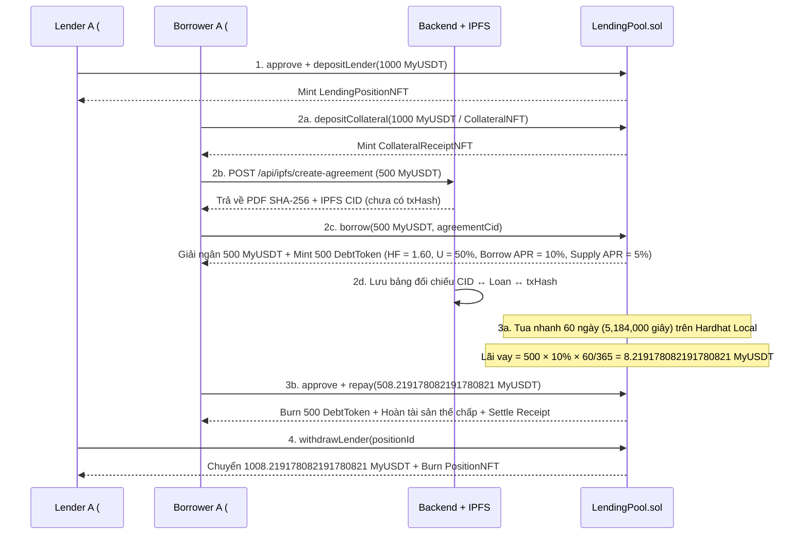

# Đặc tả Mô hình Kinh tế, Công thức Toán học & Kiến trúc Smart Contract (HI01)

Tài liệu này là **Nguồn chuẩn duy nhất (Single Source of Truth)** của nhóm **IS355.R11 – DeFi Lending DApp** do **Hiếu (`HI01`)** xây dựng dựa trên hạ tầng `Q01` (Quân) và `H01` (`MyUSDT.sol` của Hùng). Mọi hằng số và chữ ký hàm dưới đây đã được đồng bộ hóa trực tiếp vào code tại:

- **Solidity Constants & Math**: `contracts/libraries/ProtocolConstants.sol`, `contracts/libraries/ProtocolMath.sol`
- **Solidity Interfaces (7 contracts)**: `contracts/interfaces/IMyUSDT.sol`, `ICollateralNFT.sol`, `ICollateralReceiptNFT.sol`, `IDebtToken.sol`, `ILendingPositionNFT.sol`, `IPriceOracle.sol`, `ILendingPool.sol`
- **Python Backend Mirror**: `backend/config/constants.py`

---

## 1. Bảng Quy ước Hằng số & Đơn vị (Solidity ↔ Python ↔ Frontend)

| Thông số | Tên hằng số (`ProtocolConstants.sol` / `constants.py`) | Giá trị chuẩn | Diễn giải |
|---|---|---|---|
| Chuẩn số thực cố định | `WAD` | `10^18` (`1e18`) | Đơn vị base của `MyUSDT` (18 decimals theo `H01`), `DebtToken`, giá tài sản thế chấp, `Health Factor` và Interest Index |
| Chuẩn tỷ lệ cơ sở | `BPS` | `10_000` | `100.00% = 10_000 BPS`, `1 BPS = 0.01%` |
| Số giây trong 1 năm | `SECONDS_PER_YEAR` | `31_536_000` | Chính xác `365 × 86_400` giây |
| Tỷ lệ vay tối đa (Max LTV) | `MAX_LTV_BPS` | `7_000` (`70.00%`) | Ràng buộc bắt buộc Tiêu chí 1 |
| Ngưỡng thanh lý | `LIQUIDATION_THRESHOLD_BPS` | `8_000` (`80.00%`) | Dùng để tính `Health Factor` |
| Thưởng thanh lý | `LIQUIDATION_BONUS_BPS` | `500` (`5.00%`) | Phần thưởng cho Liquidator khi gọi `liquidate()` |
| Ngưỡng HF thanh lý | `HF_LIQUIDATION_THRESHOLD_WAD` | `1e18` (`1.00`) | Thanh lý chỉ hợp lệ khi **`HF < 1e18`** (`HF == 1e18` vẫn an toàn) |
| Ngưỡng HF cảnh báo | `HF_WARNING_THRESHOLD_WAD` | `1.5e18` (`1.50`) | `1.00 <= HF < 1.50`: Vàng/Cam; `HF >= 1.50`: Xanh lá |
| HF khi không có dư nợ | `INFINITE_HEALTH_FACTOR` | `type(uint256).max` ($2^{256}-1$) | Khi `TotalDebt == 0`; JSON API trả `health_factor: null, is_infinite: true` |
| Lãi vay cơ bản (Base APR) | `BASE_BORROW_APR_BPS` | `500` (`5.00%/năm`) | Lãi suất cố định tối thiểu khi Utilization = `0%` |
| Hệ số biến thiên lãi vay | `UTILIZATION_SLOPE_BPS` | `1_000` (`+10.00%/năm`) | Tăng tuyến tính từ `5.00%` (U=0%) lên `15.00%` (U=100%) |
| Tỷ lệ dự trữ giao thức | `PROTOCOL_RESERVE_FACTOR_BPS` | `0` (`0.00%`) | 100% tiền lãi người vay trả được phân bổ cho Lenders trong MVP |

> **Quy ước giá trị tài sản thế chấp (chốt giữa Hùng `H02` & Hiếu `HI02`/`HI05`)**:
> Toàn bộ hàm định giá (`CollateralNFT.valuation(tokenId)`, `PriceOracle.getCollateralTokenPrice()`, `PriceOracle.getCollateralNFTValuation(tokenId)`) **bắt buộc trả về đơn vị `MyUSDT` theo chuẩn `WAD` (`1e18`)**. Ví dụ: tài sản trị giá `1,000 MyUSDT` lưu là `1000 * 10^18`.

---

## 2. Mô hình Lãi suất Kết hợp, Phân biệt APR vs. APY & Quy tắc Không hồi tố

### 2.1. Công thức Tỷ lệ sử dụng vốn (Utilization Rate) & Lãi suất APR

- **Tỷ lệ sử dụng Pool (`utilizationBps`, trong đoạn `[0, 10_000]`)**:
  - Nếu `totalSupplied == 0` hoặc `totalBorrowed == 0`: `utilizationBps = 0`
  - Ngược lại:
    $$\text{utilizationBps} = \min\!\left(10\,000,\ \left\lfloor \frac{\text{totalBorrowed} \times 10\,000}{\text{totalSupplied}} \right\rfloor\right)$$

- **Lãi suất vay đơn theo năm (`borrowAprBps`)**:
  $$\text{borrowAprBps} = 500 + \left\lfloor \frac{\text{utilizationBps} \times 1\,000}{10\,000} \right\rfloor$$

- **Lãi suất gửi đơn theo năm (`supplyAprBps`)**:
  $$\text{supplyAprBps} = \left\lfloor \frac{\text{borrowAprBps} \times \text{utilizationBps} \times (10\,000 - \text{PROTOCOL\_RESERVE\_FACTOR\_BPS})}{10\,000 \times 10\,000} \right\rfloor$$

### 2.2. Bảng đối chiếu APR và APY quy đổi theo từng mức Utilization

> **Phân biệt bắt buộc APR vs. APY (Theo Rubric GĐ1 & HI04)**:
> - **APR (Annual Percentage Rate)** là lãi suất **đơn** tính theo từng giây `block.timestamp` trực tiếp trong Smart Contract (`borrowAprBps`, `supplyAprBps`).
> - **APY (Annual Percentage Yield)** là lãi suất hiệu dụng **quy đổi lãi kép theo ngày ($n = 365$)** chỉ dùng để hiển thị tham khảo trên Backend/Frontend:
>   $$\text{APY} = \left(1 + \frac{\text{APR}}{365}\right)^{365} - 1$$
> - Giao diện **không được ghi nhầm chữ `APY` cho giá trị thực chất là `APR`**; phải hiển thị rõ cả `APR (On-chain)` và `APY (Quy đổi lãi kép tham khảo)`.

| Utilization Rate (`U`) | `borrowAprBps` | Borrow **APR** (On-chain) | Borrow **APY** (Quy đổi ngày) | `supplyAprBps` | Supply **APR** (On-chain) | Supply **APY** (Quy đổi ngày) | Ghi chú |
|---|---|---|---|---|---|---|---|
| `0%` (`0 BPS`) | `500` | `5.00%` | `5.1267%` | `0` | `0.00%` | `0.0000%` | Pool chưa có khoản vay |
| `25%` (`2500 BPS`) | `750` | `7.50%` | `7.7876%` | `187` | `1.87%` | `1.8875%` | Thanh khoản dồi dào |
| **`50%` (`5000 BPS`)** | **`1000`** | **`10.00%`** | **`10.5156%`** | **`500`** | **`5.00%`** | **`5.1267%`** | **Kịch bản Demo chuẩn `1000 → 500`** |
| `70%` (`7000 BPS`) | `1200` | `12.00%` | `12.7475%` | `840` | `8.40%` | `8.7616%` | Sử dụng vốn cao |
| `100%` (`10000 BPS`) | `1500` | `15.00%` | `16.1798%` | `1500` | `15.00%` | `16.1798%` | Toàn bộ thanh khoản đang cho vay |

### 2.3. Công thức tính lãi theo giây (`block.timestamp`) & Quy tắc Không hồi tố

1. **Lãi đơn cho một khoảng thời gian $\Delta t = \text{block.timestamp} - t_{\text{last}}$**:
   $$\text{Interest}_{\text{WAD}} = \left\lfloor \frac{\text{principal}_{\text{WAD}} \times \text{aprBps} \times \Delta t}{31\,536\,000 \times 10\,000} \right\rfloor$$
   Trong Solidity `0.8.24` (tự chống tràn số mặc định), sử dụng `Math.mulDiv(principalWad, aprBps * deltaSeconds, SECONDS_PER_YEAR * BPS)` của OpenZeppelin v5 để tính trung gian 512-bit, chia 1 lần duy nhất ở cuối nhằm tránh mất số lẻ.

2. **Quy tắc cộng dồn lãi theo kỳ / Snapshot (Không hồi tố)**:
   - Pool duy trì hai chỉ số tích lũy `borrowIndex` và `supplyIndex` (khởi tạo `1e18` ở thời điểm deploy) cùng `lastAccrualTimestamp`.
   - **Trước mọi giao dịch làm thay đổi `totalSupplied` hoặc `totalBorrowed`** (`depositLender`, `withdrawLender`, `borrow`, `repay`, `liquidate`), Smart Contract bắt buộc gọi `_accruePoolInterest()`:
     - Chốt chỉ số tích lũy APR tuyến tính cho khoảng thời gian $\Delta t$ vừa qua bằng **mức lãi suất CŨ** (`borrowAprBps`, `supplyAprBps` trước khi thay đổi thanh khoản):
       $$\text{Index}_{\text{new}} = \text{Index}_{\text{old}} + \left\lfloor \frac{\text{WAD} \times \text{aprBps}_{\text{old}} \times \Delta t}{31\,536\,000 \times 10\,000} \right\rfloor$$
     - Lãi phát sinh của từng vị thế được tính trực tiếp từ chênh lệch chỉ số: $\text{Interest} = \left\lfloor \frac{\text{principal} \times (\text{Index}_{\text{now}} - \text{Index}_{\text{snapshot}})}{\text{WAD}} \right\rfloor$, đảm bảo tổng lãi Lender nhận không bao giờ vượt tổng lãi Borrower đóng vào Pool dù có nhiều lần trả góp một phần.
     - Cập nhật `lastAccrualTimestamp = block.timestamp`.
     - Sau khi cập nhật `totalSupplied` / `totalBorrowed`, tính lại `utilizationBps`, `borrowAprBps`, `supplyAprBps` mới và phát sự kiện `InterestRateUpdated(...)`.
   - Với từng vị thế vay hoặc gửi, trước khi thay đổi gốc `principal`, chốt phần lãi đã phát sinh từ `indexSnapshot` tới `currentIndex` vào `accruedInterest` rồi mới cập nhật `indexSnapshot = currentIndex`.
   - **Đảm bảo toán học**: Lãi suất mới chỉ áp dụng từ thời điểm giao dịch trở về sau, **tuyệt đối không áp ngược (hồi tố)** cho các kỳ trước đó.

---

## 3. Ràng buộc An toàn Vốn, Health Factor & Quy trình Thanh lý

### 3.1. Ràng buộc 1 — Tỷ lệ thế chấp tối đa (`LTV <= 70%`)
- Hạn mức vay tối đa:
  $$\text{maxBorrow}_{\text{WAD}} = \left\lfloor \frac{\text{collateralValue}_{\text{WAD}} \times 7\,000}{10\,000} \right\rfloor$$
- Khi gọi `borrow(amount, agreementCid)` hoặc `withdrawCollateral()`, bắt buộc thỏa:
  $$\text{currentTotalDebt}_{\text{WAD}} + \text{borrowAmount}_{\text{WAD}} \le \text{maxBorrow}_{\text{WAD}}$$
  Nếu vi phạm → revert `ExceedsMaxLTV(requestedDebtWad, maxBorrowableWad)`.

### 3.2. Ràng buộc 2 — Điều kiện rút tiền của Lender & Chuyển nhượng NFT vị thế
- Thanh khoản rỗi thực tế tại Pool được tính bằng **số dư token on-chain thực tế**:
  $$\text{availableLiquidity} = \text{MyUSDT.balanceOf}(\text{address(LendingPool)}) - \text{reservedLiquidity}$$
- Khi gọi `withdrawLender(positionId, amount)`:
  1. Kiểm tra `LendingPositionNFT.ownerOf(positionId) == msg.sender` (nếu Lender A đã chuyển NFT cho Lender B thì **chỉ Lender B** có quyền rút gốc + lãi; Lender A bị revert `NotPositionOwner`, tránh hưởng lãi 2 lần).
  2. Kiểm tra `amount <= claimableForPosition` (không vượt gốc + lãi được hưởng của vị thế).
  3. Kiểm tra `amount <= availableLiquidity` (bảo vệ tuyệt đối các khoản vay đang lưu hành).

### 3.3. Công thức Health Factor (`HF_WAD`) & Bảng kiểm thử biên

$$\text{HF\_WAD} = \begin{cases} 2^{256} - 1\ (\text{Vô hạn}), & \text{nếu } \text{TotalDebt} = 0 \\ \left\lfloor \dfrac{\text{CollateralValue}_{\text{WAD}} \times 8\,000 \times 10^{18}}{\text{TotalDebt}_{\text{WAD}} \times 10\,000} \right\rfloor, & \text{nếu } \text{TotalDebt} > 0 \end{cases}$$

| Kịch bản kiểm thử | `CollateralValue` (MyUSDT) | `TotalDebt` (MyUSDT) | `HF_WAD` | `HF` thập phân | Trạng thái (`HealthStatus`) | Cho phép `liquidate()`? |
|---|---|---|---|---|---|---|
| Chưa vay / Đã tất toán | `1,000` | `0` | `2^256 - 1` | `∞` (`null` trên API) | `SAFE` (Xanh lá) | **Không** |
| **Demo chuẩn (LTV 50%)** | `1,000` | `500` | `1.600000e18` | `1.60` | `SAFE` (Xanh lá) | **Không** |
| Biên giữa Xanh & Vàng | `1,000` | `533.333...` | `1.500000e18` | `1.50` | `SAFE` (Xanh lá) | **Không** |
| Vay kịch trần LTV 70% | `1,000` | `700` | `1.142857e18` | `1.142857` | `WARNING` (Vàng/Cam) | **Không** |
| **Biên chính xác `HF = 1.0`** | `1,000` | `800` | `1.000000e18` | `1.00` | `WARNING` (Vàng/Cam) | **Không** (chặn revert) |
| **Giảm giá 40% (Demo thanh lý)** | `600` | `500` | `0.960000e18` | `0.96` | `LIQUIDATABLE` (Đỏ) | **CÓ** |

### 3.4. Quy tắc kích hoạt Thanh lý (`liquidate`)
- Smart Contract **không tự chạy ngầm theo thời gian**. Khi `getHealthFactor(borrower) < 1e18`, trạng thái vị thế chuyển sang `LIQUIDATABLE`, cho phép một **Liquidator / Keeper** gửi giao dịch ký gọi `liquidate(borrower)`.
- Khi `liquidate(borrower)` thực thi:
  1. Kiểm tra `getHealthFactor(borrower) < 1e18` (nếu `>= 1e18` → revert `HealthFactorSafe`).
  2. Thu toàn bộ `totalDebt` bằng `MyUSDT` từ Liquidator vào Pool (Liquidator phải `approve` trước) và gọi `DebtToken.burn(borrower, principal)`.
  3. Tính giá trị tài sản thu giữ: $\text{seizeValue} = \min(\text{collateralValue},\ \text{debtCovered} \times 1.05)$ (gồm **5% Liquidation Bonus**).
     - Nếu thế chấp bằng **ERC-20 token**: chuyển lượng token tương ứng `seizeValue` cho Liquidator; phần dư (nếu có) hoàn về cho Borrower.
     - Nếu thế chấp bằng **`CollateralNFT` (không chia nhỏ được)**: chuyển quyền sở hữu `CollateralNFT` cho Liquidator.
  4. Gọi `CollateralReceiptNFT.settleReceipt(receiptTokenId, true)` để tất toán biên nhận thế chấp, xóa trạng thái nợ và phát sự kiện `LoanLiquidated(...)`.

---

## 4. Kiến trúc 7 Hợp đồng Thông minh & Tích hợp Off-chain

### 4.1. Sơ đồ kiến trúc tổng thể (Mermaid)



### 4.2. Thống nhất vòng đời 3 loại NFT & `DebtToken` (Chốt cho Hùng `H02` ↔ Hiếu `HI02`)

| Hợp đồng | Chuẩn | Quyền chuyển nhượng | Ai được Mint/Burn? | Vòng đời chuẩn |
|---|---|---|---|---|
| `CollateralNFT.sol` | ERC-721 + URIStorage | Chuyển được khi chưa khóa | Admin/Owner mint tài sản mẫu | Borrower sở hữu → `approve` cho Pool → `depositCollateral()` chuyển NFT vào giữ trong Pool → hoàn trả khi nợ = `0` (hoặc giao Liquidator khi thanh lý) |
| `CollateralReceiptNFT.sol` | ERC-721 | **Khóa chuyển nhượng** (Soulbound / non-transferable) | Chỉ `LendingPool` (`onlyPool`) | Mint cho Borrower ngay trong `depositCollateral()` → gọi `settleReceipt(receiptId, liquidated)` (burn hoặc đánh dấu `active = false`) khi tất toán hoặc bị thanh lý |
| `LendingPositionNFT.sol` | ERC-721 | **Chuyển nhượng tự do** (`transferFrom` / `safeTransferFrom`) | Chỉ `LendingPool` (`onlyPool`) | Mint cho Lender A khi `depositLender()` → có thể chuyển sang Lender B → `withdrawLender()` kiểm tra `ownerOf(positionId) == msg.sender` → burn khi rút hết toàn bộ gốc + lãi |
| `DebtToken.sol` | ERC-20 (`decimals=18`) | **Khóa `transfer`/`transferFrom`** | Chỉ `LendingPool` (`onlyPool`) | Mint khớp `principal` khi `borrow()` → burn khớp phần gốc trả khi `repay()` hoặc khi `liquidate()` |

---

## 5. Kịch bản Demo 4 Bước & Cân đối Kế toán Chính xác tới từng Wei

Kịch bản chuẩn GĐ4 (`1000 → 500 → Tua 60 ngày → Trả nợ → Rút vốn`) với `CollateralValue = 1,000 MyUSDT`:



**Kiểm tra cân đối kế toán sau 60 ngày (`5,184,000` giây)**:
- Lãi Borrower phải trả: `floor(500e18 * 1000 * 5184000 / (31536000 * 10000)) = 8_219_178_082_191_780_821` wei (`8.219178... MyUSDT`).
- Lãi Lender được hưởng: `floor(1000e18 * 500 * 5184000 / (31536000 * 10000)) = 8_219_178_082_191_780_821` wei (`8.219178... MyUSDT`).
- Số dư Pool còn lại sau khi Lender rút hết: **`0` wei** (cân bằng tuyệt đối).

### 5.1. Luồng dữ liệu On-chain ↔ IPFS & Phân quyền RBAC (Chốt cho Hùng `H03`, Quân `Q03`–`Q05`, Lâm `L04`)

| Nhóm hồ sơ IPFS | Thời điểm tạo & liên kết On-chain | Dữ liệu đầu vào từ Smart Contract | Phân loại truy cập & Mã hóa |
|---|---|---|---|
| **1. Loan Agreement (PDF)** | Sinh PDF + SHA-256 + upload IPFS lấy `CID` **trước** khi gọi `borrow(amount, cid)`; lưu `cid` on-chain trong `LoanPosition.ipfsAgreementCid` và phát trong `LoanBorrowed`. Sau khi có `txReceipt`, Backend lưu bảng đối chiếu `CID ↔ Loan ↔ txHash` (không ghi `txHash` giả vào PDF ban đầu). | Địa chỉ ví Borrower, định giá từ `PriceOracle`, `MAX_LTV_BPS (70%)`, `LIQUIDATION_THRESHOLD_BPS (80%)`, `borrowAprBps` (và APY quy đổi). | Riêng tư theo chủ khoản vay (`Borrower` chủ sở hữu / `Admin`); mã hóa `AES-256-GCM` nếu chứa dữ liệu nhạy cảm. |
| **2. Credit Report (JSON)** | Backend (`Q04`) quét sự kiện on-chain theo địa chỉ ví → chấm điểm tín dụng `300–850` → mã hóa → đẩy IPFS nhận `CID`. | Quét 4 Events: `CollateralDeposited`, `LoanBorrowed`, `LoanRepaid`, `LoanLiquidated` + `getTotalDebt(borrower)`. | **Bắt buộc riêng tư** (mã hóa `AES-256-GCM` trước khi upload; chỉ ví chủ sở hữu hoặc `Admin` đã ký nonce RBAC mới giải mã được, ví khác trả `HTTP 401/403`). |
| **3. Audit Logs (JSON)** | Backend (`Q04`) tổng hợp lịch sử biến động lãi suất theo tháng → đẩy IPFS nhận `CID`. | Quét Event `InterestRateUpdated(timestamp, borrowAprBps, supplyAprBps, utilizationBps, totalSuppliedWad, totalBorrowedWad)` *(dữ liệu seed 6 tháng đầu gắn nhãn rõ là `SIMULATED`)*. | **Công khai** (chỉ chứa số liệu tổng hợp toàn Pool, không chứa dữ liệu cá nhân hay khóa bí mật). |

---

## 6. Bảng Chữ ký Hàm, Events & Chuẩn JSON API (Bàn giao cho Quân & Lâm)

### 6.1. Các hàm Write bắt buộc trên `ILendingPool`
| Hàm | Người gọi | Điều kiện tiên quyết | Hiệu ứng chính |
|---|---|---|---|
| `depositLender(uint256 amount)` | Lender | Đã `MyUSDT.approve(pool, amount)` | Chốt lãi cũ, nhận `MyUSDT`, mint `LendingPositionNFT`, cập nhật rate |
| `withdrawLender(uint256 positionId, uint256 amount)` | Chủ `positionId` hiện tại | `ownerOf(positionId) == msg.sender`, `amount <= availableLiquidity`, `amount <= claimable` | Trả gốc + lãi từ Pool, burn NFT nếu rút hết |
| `depositCollateral(uint256 amountOrTokenId, bool isNFT)` | Borrower | Đã `approve` ERC-20 hoặc `CollateralNFT` | Khóa tài sản vào Pool, mint `CollateralReceiptNFT`, phát `CollateralDeposited` |
| `withdrawCollateral()` | Borrower | `totalDebt == 0` | Mở khóa tài sản thế chấp, `settleReceipt(receiptId, false)` |
| `borrow(uint256 amount, string agreementCid)` | Borrower | Có thế chấp, `agreementCid` không rỗng, `debt + amount <= maxBorrow` (70% LTV), `amount <= availableLiquidity` | Lưu CID on-chain, mint `DebtToken`, chuyển `MyUSDT`, phát `LoanBorrowed` |
| `repay(uint256 amount)` | Borrower | Đã `MyUSDT.approve(pool, amount)` | Thu nợ (ưu tiên trả lãi trước, gốc sau), burn `DebtToken`; nếu nợ = `0` tự mở khóa thế chấp & settle biên nhận |
| `liquidate(address borrower)` | Liquidator / Keeper | `getHealthFactor(borrower) < 1e18`, đã `MyUSDT.approve(pool, totalDebt)` | Thu nợ vào Pool, burn `DebtToken`, giao tài sản thế chấp (+5% bonus) cho Liquidator, settle biên nhận |

### 6.2. Các hàm View phục vụ Web3.py (`Q02`/`Q05`) & Frontend (`L02`/`L03`)
- `getPoolInfo()` → trả về `PoolInfo` (tổng gửi, tổng vay, chỉ số lãi, `borrowAprBps`, `supplyAprBps`, `utilizationBps`).
- `getInterestRateSnapshot()` → trả về `InterestRateSnapshot` tách rõ `borrowAprBps`/`supplyAprBps` (on-chain đơn) và `borrowApyRefBps`/`supplyApyRefBps` (tham khảo quy đổi lãi kép ngày) kèm chỉ số tích lũy live (`HI04`).
- `getAvailableLiquidity()` → `MyUSDT.balanceOf(address(this)) - reservedLiquidity - totalTokenCollateralLocked` (khi `collateralToken == myUSDT`).
- `getCollateralValue(borrower)` → giá trị định giá hiện tại theo `PriceOracle` (WAD `1e18`).
- `getMaxBorrowable(borrower)` → trần tổng nợ `(collateralValue * 7000) / 10000` (WAD `1e18`).
- `getRemainingBorrowCapacity(borrower)` → hạn mức LTV còn lại `max(0, maxBorrowable - totalDebt)` (WAD `1e18`).
- `getAvailableToBorrow(borrower)` → hạn mức vay thêm thực tế `min(remainingBorrowCapacity, availableLiquidity)` (WAD `1e18`).
- `getCurrentLtvBps(borrower)` → tỷ lệ LTV hiện tại theo `BPS` (`0` khi không có nợ).
- `calculateAccruedInterest(borrower)`, `previewBorrowerInterest(borrower, extraSeconds)` & `getTotalDebt(borrower)` → tiền lãi realtime, dự phóng sau `extraSeconds` và tổng dư nợ (WAD `1e18`).
- `getHealthFactor(borrower)` → `HF_WAD` (`1e18`, hoặc `type(uint256).max` nếu nợ = 0).
- `getLenderEarnedInterest(positionId)`, `previewLenderEarnedInterest(positionId, extraSeconds)`, `getLenderClaimableBalance(positionId)` & `getMaxWithdrawable(positionId)` → lãi tích lũy, dự phóng lãi gửi, tổng quyền rút và hạn mức rút thực tế của vị thế NFT.
- `accrueInterest()` *(write, permissionless)* → chốt chỉ số lãi tích lũy tới `block.timestamp` và phát sự kiện `InterestRateUpdated` phục vụ `Q04` Audit Logs.

### 6.3. Danh sách Events chuẩn (Quân `Q04` quét làm Credit Report & Audit Logs)
1. `LenderDeposited(address indexed lender, uint256 indexed positionId, uint256 amountWad, uint256 timestamp)`
2. `LenderWithdrawn(address indexed owner, uint256 indexed positionId, uint256 principalWithdrawnWad, uint256 interestWithdrawnWad, uint256 timestamp)`
3. `CollateralDeposited(address indexed borrower, bool isNFT, uint256 assetIdOrAmount, uint256 indexed receiptTokenId, uint256 valuationWad, uint256 timestamp)`
4. `CollateralWithdrawn(address indexed borrower, bool isNFT, uint256 assetIdOrAmount, uint256 indexed receiptTokenId, uint256 timestamp)`
5. `LoanBorrowed(address indexed borrower, uint256 amountWad, uint256 totalPrincipalWad, uint256 borrowAprBps, string agreementCid, uint256 timestamp)`
6. `LoanRepaid(address indexed borrower, uint256 amountPaidWad, uint256 interestPaidWad, uint256 principalPaidWad, uint256 remainingDebtWad, uint256 timestamp)`
7. `LoanLiquidated(address indexed borrower, address indexed liquidator, uint256 debtCoveredWad, uint256 collateralSeizedWad, uint256 healthFactorBeforeWad, uint256 timestamp)`
8. `InterestRateUpdated(uint256 timestamp, uint256 borrowAprBps, uint256 supplyAprBps, uint256 utilizationBps, uint256 totalSuppliedWad, uint256 totalBorrowedWad)`

### 6.4. Quy ước định dạng JSON API giữa Quân (`Q05`) & Lâm (`L01`–`L05`)
Để tránh lỗi tràn số JavaScript `Number` với `uint256` (nhất là khi `HF = 2^256 - 1`), Backend `backend/config/constants.py` chuẩn hóa response như sau:
- Tiền tệ (`MyUSDT`, nợ, lãi): trả song song chuỗi Wei nguyên (`amount_wad: "500000000000000000000"`) và chuỗi thập phân hiển thị (`amount_display: "500.000000"`).
- Lãi suất: trả rõ `borrow_apr_bps`, `borrow_apr_percent` (on-chain), `borrow_apy_percent` (quy đổi tham khảo), `supply_apr_bps`, `supply_apr_percent`, `supply_apy_percent`.
- Health Factor (qua hàm `format_health_factor_for_api`):
  ```json
  {
    "health_factor_wad": "1600000000000000000",
    "health_factor": 1.6,
    "is_infinite": false,
    "status": "SAFE",
    "liquidatable": false
  }
  ```

---

## 7. Checklist Nghiệm thu `HI01`

- [x] Chốt công thức lãi suất kết hợp (Base APR 5% + Slope 10% theo Utilization), phân biệt rõ **APR vs. APY** và quy tắc cộng dồn theo kỳ không hồi tố.
- [x] Chốt thông số an toàn vốn: `MAX_LTV_BPS = 7000` (70%), `LIQUIDATION_THRESHOLD_BPS = 8000` (80%), `LIQUIDATION_BONUS_BPS = 500` (5%), `SECONDS_PER_YEAR = 31_536_000`.
- [x] Chốt công thức `Health Factor` theo `BPS`/`WAD (1e18)` và kiểm thử tự động biên **`HF = 1.0`** lẫn **`TotalDebt = 0`** ở cả Hardhat (`tests/HI01_ProtocolMath.test.js`) và Pytest (`tests/test_hi01_constants.py`).
- [x] Chuẩn hóa toàn bộ 7 Solidity Interface trong `contracts/interfaces/` và đồng bộ hằng số sang `backend/config/constants.py`.
