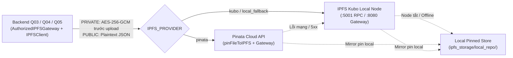
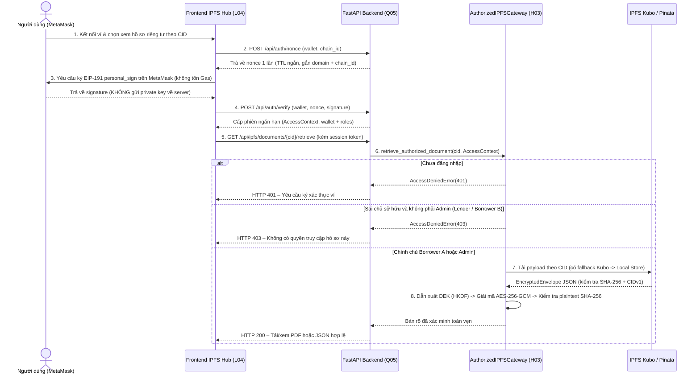

# H03 – Hạ tầng IPFS Node / Pinata, Cấu trúc 3 Loại Hồ sơ, Mã hóa AES-256-GCM & Ma trận RBAC (Hùng, Giai đoạn 2)

## 1. Điều kiện tiên quyết đã kiểm tra & phạm vi bàn giao

H03 phụ thuộc trực tiếp vào **Q01** và tuân thủ đồng bộ các đặc tả đã chốt ở **HI01** và **L01**:

| Đầu vào | File đã có trên nhánh `main` | Cách sử dụng trong H03 |
|---|---|---|
| **Q01 – Quân** | [`.env.example`](../../.env.example), [`requirements.txt`](../../requirements.txt), [`backend/config/settings.py`](../../backend/config/settings.py), [hướng dẫn Q01](../Quan/q01_environment_and_metamask_guide.md) | Biến môi trường IPFS Kubo/Pinata, `DOCUMENT_AES_KEY_HEX`, danh sách ví test cố định (`#0` Admin, `#1` Lender A, `#2` Borrower A, `#5` Borrower B), thư viện `requests`, `reportlab`, `cryptography`, `pydantic` |
| **HI01 – Hiếu** | [Đặc tả HI01 §5.1](../Hieu/smart_contract_spec.md), [`backend/config/constants.py`](../../backend/config/constants.py) | Hằng số `MAX_LTV_BPS = 7000`, `LIQUIDATION_THRESHOLD_BPS = 8000`, `LIQUIDATION_BONUS_BPS = 500`, công thức APR vs APY quy đổi, danh sách 4 Event Credit Report và Event `InterestRateUpdated`, quy tắc không ghi `txHash` giả vào PDF trước khi `borrow()` xác nhận |
| **L01 – Lâm** | [Wireframe & RBAC §6](../Lam/ui_wireframes.md), [API contract §6](../Lam/l01_api_contract.md) | Đồng nhất phân quyền `GUEST / LENDER / BORROWER / ADMIN`, mã lỗi `401 / 403`, nhãn `SIMULATED` và luồng tra cứu CID trên màn hình IPFS Hub |

**Phạm vi của H03**:
- Cung cấp thư viện Python tái sử dụng tại [`src/ipfs/`](../../src/ipfs/README.md) và [`src/documents/`](../../src/documents/README.md), bộ JSON Schema & dữ liệu mẫu tại [`ipfs_storage/`](../../ipfs_storage/README.md), script vận hành Kubo local và script kiểm thử `scripts/verify_h03_ipfs.py`.
- **Không** xây dựng thay các route FastAPI runtime của Quân (`Q03`, `Q04`, `Q05`) hay giao diện React IPFS Hub của Lâm (`L04`); thay vào đó cung cấp module plug-and-play để Quân và Lâm import trực tiếp.

---

## 2. Thiết lập IPFS Kubo Local Node & Pinata Cloud API

Hệ thống hỗ trợ linh hoạt 3 tầng lưu trữ/truy xuất với cơ chế **tự động dự phòng (fallback)** nhằm tránh rủi ro rớt mạng khi demo (Tiêu chí 3 & `Q07`):



### 2.1. Quy tắc bảo mật `.env` (Bắt buộc)
1. Sao chép `.env.example` sang `.env` tại thư mục gốc (file `.env` đã bị chặn bởi `.gitignore` — **tuyệt đối không commit** lên GitHub).
2. Sinh khóa AES-256 mới (64 ký tự hex = 32 bytes) cho môi trường cục bộ, không dùng lại giá trị mẫu trong `.env.example` khi chạy thật:
   ```powershell
   python -c "import secrets; print(secrets.token_hex(32))"
   ```
   Điền vào `DOCUMENT_AES_KEY_HEX=<64_hex_chars>` trong `.env`.
3. Không đặt `PINATA_JWT`, `PINATA_API_KEY`, `PINATA_SECRET_API_KEY` hay `DOCUMENT_AES_KEY_HEX` vào metadata ghim IPFS, file PDF/JSON hay Smart Contract. `IPFSClient` chủ động chặn và báo lỗi nếu phát hiện khóa nhạy cảm trong pin metadata.

### 2.2. Phương án A – Chạy IPFS Kubo Local Node (Khuyến nghị khi phát triển & dự phòng phòng thi)
- Cài Kubo CLI theo tài liệu chính thức: <https://docs.ipfs.tech/install/command-line/> (hoặc dùng Docker):
  ```powershell
  docker run -d --name is355-ipfs-kubo -p 4001:4001 -p 127.0.0.1:8080:8080 -p 127.0.0.1:5001:5001 ipfs/kubo:latest
  ```
- Khởi chạy bằng script chuẩn hóa:
  ```powershell
  # Windows
  .\scripts\start_ipfs_node.bat
  # macOS / Linux
  ./scripts/start_ipfs_node.sh
  ```
- Đặt trong `.env`: `IPFS_PROVIDER=kubo` (hoặc `local_fallback`), `IPFS_LOCAL_API_URL=http://127.0.0.1:5001`, `IPFS_LOCAL_GATEWAY_URL=http://127.0.0.1:8080/ipfs`.

### 2.3. Phương án B – Kết nối Pinata Cloud API
1. Đăng ký tài khoản Pinata miễn phí tại <https://app.pinata.cloud/> → tạo API Key (quyền `pinFileToIPFS`, `pinJSONToIPFS`) và copy **JWT**.
2. Điền vào `.env`:
   ```env
   IPFS_PROVIDER=pinata
   PINATA_JWT=<your_pinata_jwt>
   PINATA_GATEWAY_URL=https://gateway.pinata.cloud/ipfs
   ```
3. Kiểm thử upload & truy xuất sống (tắt fallback offline để xác nhận ghim thật trên Kubo/Pinata):
   ```powershell
   python scripts/verify_h03_ipfs.py --mode live
   ```

---

## 3. Cấu trúc 3 Loại Hồ sơ Bắt buộc (+ Ảnh PNG tùy chọn)

Toàn bộ schema được định nghĩa bằng Pydantic v2 tại [`src/documents/schemas.py`](../../src/documents/schemas.py), đồng bộ hằng số từ [`backend/config/constants.py`](../../backend/config/constants.py), và xuất ra JSON Schema chuẩn tại [`ipfs_storage/schemas/`](../../ipfs_storage/README.md):

| Loại hồ sơ | Định dạng | Phân loại truy cập | Mã hóa IPFS | Schema JSON & Template |
|---|---|---|---|---|
| **1. Loan Agreement** | `PDF` | `PRIVATE` | Bắt buộc (`AES-256-GCM`) | [`loan_agreement.schema.json`](../../ipfs_storage/schemas/loan_agreement.schema.json), [`loan_tx_binding.schema.json`](../../ipfs_storage/schemas/loan_tx_binding.schema.json), [`loan_agreement_template.py`](../../src/documents/loan_agreement_template.py) |
| **2. Credit Report** | `JSON` | `PRIVATE` | Bắt buộc (`AES-256-GCM`) | [`credit_report.schema.json`](../../ipfs_storage/schemas/credit_report.schema.json) |
| **3. Audit Logs** | `JSON` & `CSV` | `PUBLIC` | Không (chỉ số tổng hợp, không PII) | [`audit_logs.schema.json`](../../ipfs_storage/schemas/audit_logs.schema.json) |
| **4. Collateral Proof *(tùy chọn)*** | `PNG` | `PRIVATE` | Bắt buộc (`AES-256-GCM`) | [`collateral_proof_template.py`](../../src/documents/collateral_proof_template.py) |

### Quy tắc nghiệp vụ quan trọng được cưỡng chế trong Schema
1. **Loan Agreement (PDF)**:
   - Chứa đầy đủ: `agreement_id`, `agreement_nonce`, thời gian `UTC` & `UTC+7`, `borrower_wallet`, tài sản thế chấp (ERC-20 / `CollateralNFT` + định giá WAD & display), `principal`, `MAX_LTV_BPS = 7000` (70%), `LIQUIDATION_THRESHOLD_BPS = 8000` (80%), `LIQUIDATION_BONUS_BPS = 500` (5%).
   - Tách bạch **Borrow APR (lãi đơn on-chain theo giây)** và **Borrow APY (quy đổi lãi kép theo ngày $n=365$ chỉ mang tính tham khảo)**.
   - **Không ghi `txHash` giả**: Khi `status == "PRE_BORROW_UNSIGNED"`, schema **bắt buộc `tx_hash = null`**. Sau khi giao dịch `borrow(amount, cid)` có receipt xác nhận, Q03/Q05 ghi bản ghi đối chiếu theo schema `LoanTxBindingRecord` (`CID ↔ Loan ID ↔ TxHash`).
2. **Credit Report (JSON)**:
   - Chứa địa chỉ ví, `total_loans`, `repaid_on_time_count`, `active_loans_count`, `liquidation_count`, tổng vay/đã trả/dư nợ hiện tại (chuỗi WAD + display), điểm tín dụng phi tập trung `300–850`, danh sách `loan_ids` & `loans`, cùng 4 nguồn sự kiện HI01 (`CollateralDeposited`, `LoanBorrowed`, `LoanRepaid`, `LoanLiquidated`).
3. **Audit Logs (JSON/CSV)**:
   - Chỉ chứa số liệu tổng hợp toàn Pool theo từng tháng (`YYYY-MM`): `total_supplied`, `total_borrowed`, `available_liquidity`, `utilization_bps`, `borrow_apr/apy`, `supply_apr/apy`; `contains_pii = false`.
   - Dữ liệu seed 6 tháng đầu gắn nhãn rõ `data_kind = "SIMULATED"`, tách biệt hoàn toàn khỏi sự kiện `InterestRateUpdated` thật trên chuỗi.

---

## 4. Kiến trúc Mã hóa AES-256-GCM & Quy trình Quản lý Khóa

Module [`src/ipfs/encryption.py`](../../src/ipfs/encryption.py) triển khai mã hóa xác thực **AES-256-GCM** kết hợp dẫn xuất khóa **HKDF-SHA256**:

1. **Tách khóa chủ (Master Key) và khóa tài liệu (DEK)**:
   - Backend giữ duy nhất `DOCUMENT_AES_KEY_HEX` (32 bytes = 256-bit) trong `.env` (hoặc KMS ở môi trường triển khai thật).
   - Mỗi lần mã hóa một tài liệu, hệ thống sinh ngẫu nhiên `salt` (16 bytes) và dẫn xuất **DEK 256-bit riêng biệt** qua `HKDF-SHA256(master_key, salt, info="is355-defi-lending:ipfs-dek:v1:<document_type>:<owner_wallet>")`.
2. **Nonce/IV độc nhất & AAD chống tráo đổi**:
   - Mỗi lần mã hóa sinh mới một **nonce/IV 96-bit (12 bytes)** bằng `os.urandom(12)` — không bao giờ tái sử dụng nonce.
   - **AAD (Additional Authenticated Data)** gắn chặt `(schema_version, document_type, owner_wallet, visibility, key_id)` vào thẻ xác thực GCM tag, ngăn chặn kẻ tấn công tráo bản mã giữa các ví hoặc loại tài liệu khác nhau.
3. **Cấu trúc Envelope đẩy lên IPFS** ([`encrypted_envelope.schema.json`](../../ipfs_storage/schemas/encrypted_envelope.schema.json)):
   - Chỉ lưu `ciphertext_b64`, `nonce_b64`, `key_salt_b64`, `aad_b64`, `key_id`, `owner_wallet`, `plaintext_sha256` và metadata không nhạy cảm.
   - **Tuyệt đối không chứa** khóa AES, Master Key, DEK hay bản rõ (plaintext). Bất kỳ ai biết mã CID đều chỉ tải về được bản mã JSON; không thể giải mã nếu không đi qua Backend RBAC.
4. **Kiểm tra toàn vẹn 2 lớp khi giải mã**:
   - Lớp 1: `IPFSClient.retrieve_bytes()` xác minh mã băm SHA-256 và CIDv1 của payload tải từ IPFS.
   - Lớp 2: `DocumentEncryptor.decrypt_envelope()` xác minh GCM authentication tag + AAD + đối chiếu `SHA-256(plaintext) == envelope.plaintext_sha256`.

---

## 5. Ma trận Phân quyền RBAC & Luồng Cấp quyền Giải mã (Bàn giao Q05 & L04)

Định nghĩa chính thức tại [`src/ipfs/rbac.py`](../../src/ipfs/rbac.py) và [`ipfs_storage/schemas/rbac_matrix.json`](../../ipfs_storage/schemas/rbac_matrix.json):

| Tài nguyên / Thao tác | `GUEST` (Chưa ký phiên) | `LENDER` (Ví khác) | `BORROWER` (Chính chủ) | `BORROWER` (Ví khác) | `ADMIN` (Đã xác thực) |
|---|---|---|---|---|---|
| **Audit Logs (JSON/CSV)** – Đọc | **ALLOW (200)** | **ALLOW (200)** | **ALLOW (200)** | **ALLOW (200)** | **ALLOW (200)** |
| **Audit Logs** – Xuất bản (Upload) | DENY (401) | DENY (403) | DENY (403) | DENY (403) | **ALLOW (200)** |
| **Loan Agreement (PDF)** – Giải mã bản rõ | DENY (**401**) | DENY (**403**) | **ALLOW (200)** | DENY (**403**) | **ALLOW (200)** |
| **Credit Report (JSON)** – Giải mã bản rõ | DENY (**401**) | DENY (**403**) | **ALLOW (200)** | DENY (**403**) | **ALLOW (200)** |
| **Collateral Proof (PNG)** – Giải mã bản rõ | DENY (**401**) | DENY (**403**) | **ALLOW (200)** | DENY (**403**) | **ALLOW (200)** |
| **Truy cập trực tiếp Public Gateway bằng CID** | Chỉ thấy bản mã | Chỉ thấy bản mã | Chỉ thấy bản mã | Chỉ thấy bản mã | Chỉ thấy bản mã |

### Luồng xác thực chữ ký ví & giải mã hồ sơ riêng tư (Cho Q05 + L04)



---

## 6. Hướng dẫn tích hợp nhanh cho Quân (`Q03`, `Q04`, `Q05`) & Lâm (`L04`)

### 6.1. Sinh Loan Agreement PDF, mã hóa & đẩy IPFS trước khi gọi `borrow()` (Quân – `Q03`)
```python
from src.documents import LoanAgreementPayload, render_loan_agreement_pdf
from src.ipfs import AuthorizedIPFSGateway, DocumentEncryptor, DocumentType, IPFSClient

client = IPFSClient()  # Tự đọc cấu hình từ .env (Pinata / Kubo / Local Fallback)
encryptor = DocumentEncryptor.from_env("DOCUMENT_AES_KEY_HEX")
gateway = AuthorizedIPFSGateway(ipfs_client=client, encryptor=encryptor)

pdf_bytes = render_loan_agreement_pdf(payload)  # payload.tx_hash MUST be None
upload_res, acl_meta, _ = gateway.upload_document(
    pdf_bytes,
    document_type=DocumentType.LOAN_AGREEMENT,
    filename=f"{payload.agreement_id}.pdf",
    owner_wallet=payload.borrower_wallet,
)
# Truyền upload_res.cid vào unsigned tx LendingPool.borrow(amount_wad, upload_res.cid)
```

### 6.2. Truy xuất hồ sơ kèm kiểm tra RBAC 401/403 (Quân – `Q05`)
```python
from src.ipfs import AccessContext, AccessDeniedError, Role

ctx = AccessContext.for_wallet(verified_wallet, roles={Role.BORROWER})
try:
    doc = gateway.retrieve_authorized_document(cid, ctx, metadata=acl_from_db)
    # Trả HTTP 200 kèm doc.content, doc.content_type, doc.plaintext_sha256
except AccessDeniedError as err:
    # Trả HTTP err.http_status (401 hoặc 403) kèm err.reason
    raise
```

### 6.3. Xuất bản Audit Logs công khai (Quân – `Q04`)
```python
from src.documents import AuditLogsDocument, audit_logs_to_csv
from src.ipfs import DocumentType, DocumentVisibility

audit_bytes = audit_doc.model_dump_json(indent=2).encode("utf-8")
upload_res, acl_meta, _ = gateway.upload_document(
    audit_bytes,
    document_type=DocumentType.AUDIT_LOGS,
    filename="audit_logs.json",
    visibility=DocumentVisibility.PUBLIC,
)
```

### 6.4. Quy ước hiển thị cho Frontend IPFS Hub (Lâm – `L04`)
- Hồ sơ `PUBLIC` (`AUDIT_LOGS`): cho phép tra cứu trực tiếp qua CID và mở link Gateway; hiển thị rõ badge `SIMULATED` cho các kỳ dữ liệu seed 6 tháng đầu.
- Hồ sơ `PRIVATE` (`LOAN_AGREEMENT`, `CREDIT_REPORT`, `COLLATERAL_PROOF`): luôn gọi qua endpoint Backend xác thực phiên ví; hiển thị rõ thông báo khi nhận `401` (*"Vui lòng kết nối và ký xác thực ví"*) hoặc `403` (*"Ví hiện tại không có quyền giải mã hồ sơ này"*); không dùng link Public Gateway để kỳ vọng xem được bản rõ.

---

## 7. Tài liệu tham khảo chính thức

- [IPFS Content Identifiers (CID) Specification](https://docs.ipfs.tech/concepts/content-addressing/)
- [IPFS Kubo HTTP RPC API Reference](https://docs.ipfs.tech/reference/kubo/rpc/)
- [Pinata Cloud Pinning API Documentation](https://docs.pinata.cloud/)
- [NIST SP 800-38D – Galois/Counter Mode (AES-GCM)](https://csrc.nist.gov/publications/detail/sp/800-38d/final)
- [RFC 5869 – HMAC-based Extract-and-Expand Key Derivation Function (HKDF)](https://datatracker.ietf.org/doc/html/rfc5869)

