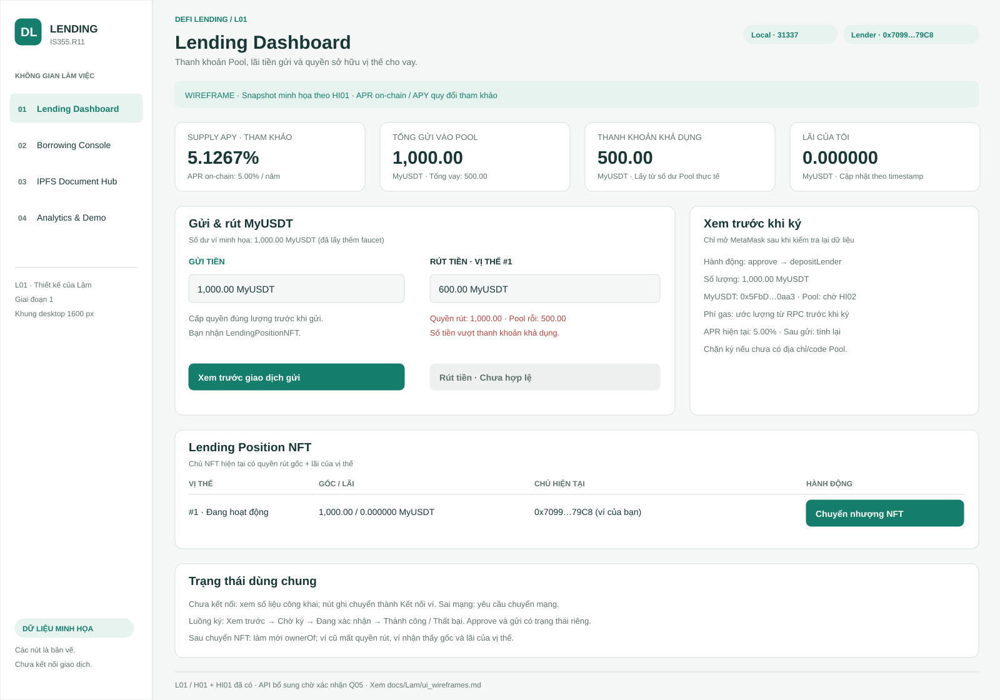
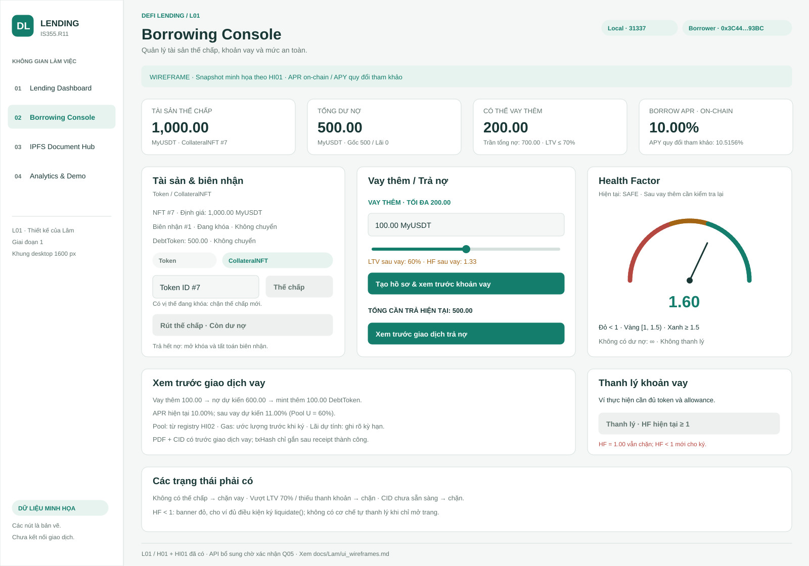
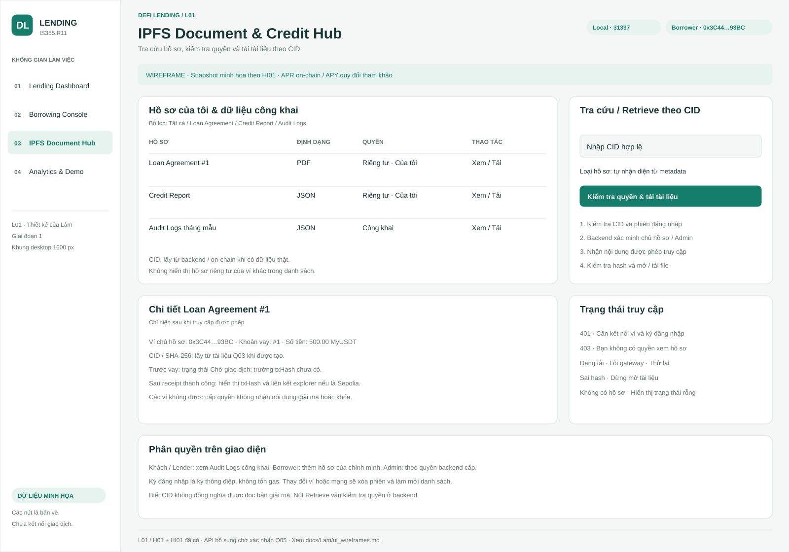
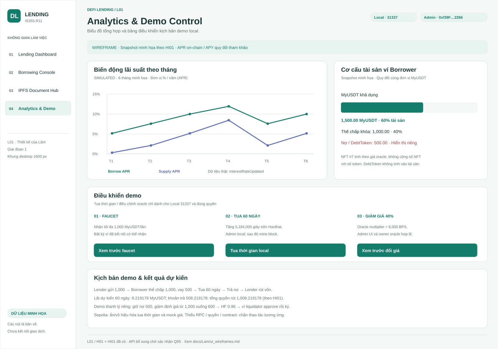
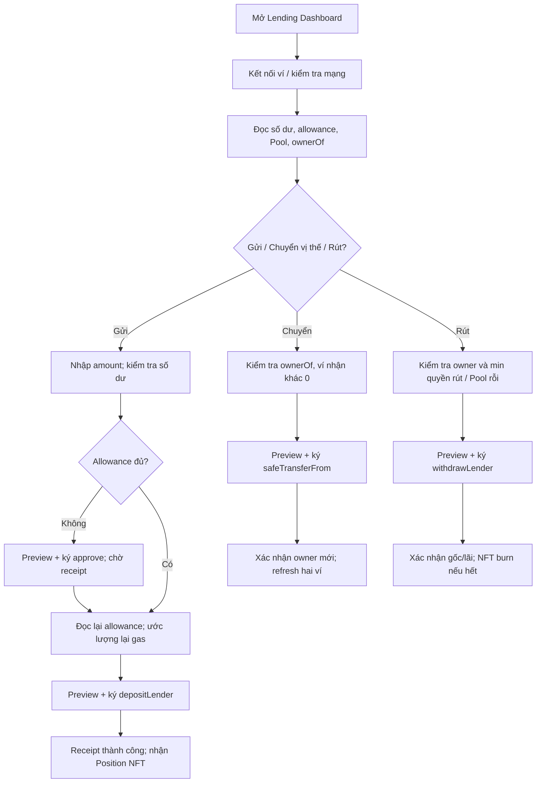
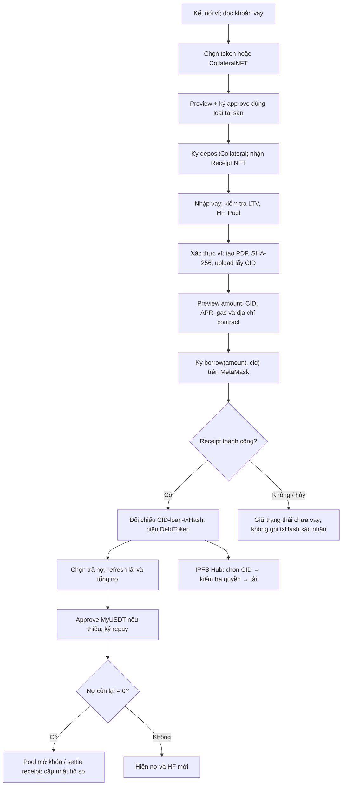
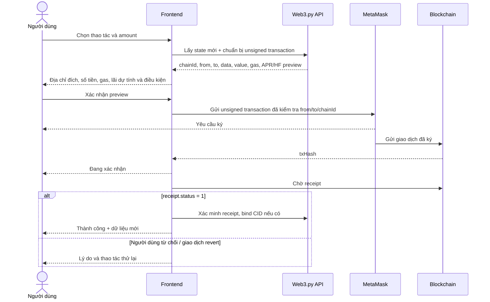

# L01 – Phân tích chức năng & wireframe DApp (Lâm, Giai đoạn 1)

## 1. Phạm vi và đầu vào đã kiểm tra

L01 bàn giao thiết kế cho L02 (Lending Dashboard), L03 (Borrowing Console),
L04 (IPFS Hub / biểu đồ), L05 (tích hợp ví) và Quân Q05 (API).
Đây là bộ bản vẽ và đặc tả; không thay thế frontend React hoặc bằng chứng giao dịch chạy thật.

| Đầu vào | File đã có | Cách sử dụng |
|---|---|---|
| H01 – Hùng | [MyUSDT](../../contracts/tokens/MyUSDT.sol), [ABI](../../deployments/abi/MyUSDT.json), [bàn giao](../Hung/h01_myusdt_handoff.md) | 18 decimals, faucet tối đa 1,000 MyUSDT/lần, approve/allowance |
| HI01 – Hiếu | [Đặc tả](../Hieu/smart_contract_spec.md), [ILendingPool](../../contracts/interfaces/ILendingPool.sol), [constants](../../backend/config/constants.py) | Chữ ký hàm/event, lãi suất, HF, LTV, NFT và quyền |
| Q01 – Quân | [Hướng dẫn](../Quan/q01_environment_and_metamask_guide.md), [registry](../../backend/config/contracts.json) | Local 31337, Sepolia 11155111, ví và cấu hình mạng |

H01 và HI01 là hai phụ thuộc của L01 trong sheet `23 cong viec goc`, dòng L01.
Các đầu vào này đã có trên nhánh `feature/lam-l01-ui-wireframe`.
Implementation Pool/NFT/IPFS ở H02, HI02–HI05, H03, Q03–Q05 là đầu vào cho
những bước tích hợp sau; bản vẽ dùng đúng interface HI01 và ghi rõ dữ liệu minh họa.

## 2. Bộ bản vẽ và cách mở

| Màn hình | Bản SVG xem trực tiếp | Phần nhận bàn giao |
|---|---|---|
| 01 – Lending Dashboard | [SVG](wireframes/01-lending-dashboard.svg) | L02 |
| 02 – Borrowing Console | [SVG](wireframes/02-borrowing-console.svg) | L03 |
| 03 – IPFS Document & Credit Hub | [SVG](wireframes/03-ipfs-document-hub.svg) | L04 |
| 04 – Analytics & Demo Control | [SVG](wireframes/04-analytics-demo.svg) | L04 / L06 |

- [File Draw.io 4 trang, các hình/nhãn sửa được](wireframes/l01-ui-wireframes.drawio):
  mở Draw.io / diagrams.net, chọn **File → Open From → Device**.
- [Đặc tả dữ liệu và đề xuất API](l01_api_contract.md).
- [JSON ví dụ theo hằng số HI01](wireframes/l01-ui-examples.json), gắn nhãn `SIMULATED`.
- Sinh lại SVG, Draw.io và JSON từ cùng một nguồn:
  `python scripts/generate_l01_wireframes.py` (chỉ dùng thư viện chuẩn Python và constants đã có).
  Chỉnh trực tiếp Draw.io không tự cập nhật SVG; khi cần đồng bộ, sửa script rồi sinh lại.

### 01 – Lending Dashboard

- KPI: Supply APY quy đổi tham khảo, Supply APR on-chain, tổng gửi, tổng vay,
  thanh khoản khả dụng và lãi của các vị thế hiện đang thuộc ví.
- Form gửi/rút; mỗi thao tác mở phần xem trước, có gas và lãi dự tính trước popup ký.
- Rút tối đa `min(claimableForPosition, availableLiquidity)`; không dùng
  `totalSupplied - totalBorrowed` thay cho số dư Pool thực tế.
- Bảng LendingPositionNFT: positionId, gốc, lãi, tổng quyền rút, owner và chuyển nhượng.
  Sau transfer phải đọc lại `ownerOf`; ví cũ mất quyền rút, ví nhận được gốc+lãi.
- Không cung cấp chuyển nhượng CollateralReceiptNFT hoặc DebtToken.

### 02 – Borrowing Console

- Thế chấp ERC-20 / CollateralNFT; hiển thị định giá WAD quy đổi MyUSDT,
  biên nhận thế chấp, trạng thái khóa và DebtToken.
- Trần **tổng nợ** là `floor(collateralValue * 7000 / 10000)`.
  Vay thêm tối đa `max(0, min(maxTotalDebt - totalDebt, availableLiquidity))`.
  Slider và nhập tay đều chặn mức này; so sánh bằng số nguyên, không chỉ kiểm tra màu slider.
- Xem trước khoản vay: khoản vay thêm, tổng nợ dự kiến, LTV, HF sau giao dịch,
  lượng DebtToken dự kiến mint, APR hiện tại/sau vay, kỳ hạn lãi minh họa và gas.
- APR on-chain và APY quy đổi tham khảo luôn có nhãn khác nhau.
- HF: xanh khi `HF >= 1.5`; vàng khi `1 <= HF < 1.5`; đỏ khi `HF < 1`.
  **HF = 1 vẫn chặn liquidate**. Không nợ: hiện `∞`, không thanh lý.
  Quyết định dùng `health_factor_wad`/BigInt, không dùng HF đã làm tròn trên màn hình.
- Thanh lý cần một ví đủ token/allowance ký `liquidate(borrower)`;
  việc HF giảm không tự sinh giao dịch.
- Trả nợ ưu tiên lãi rồi gốc; trả hết thì Pool mở khóa tài sản, tất toán biên nhận.
  Nút rút thế chấp thủ công chỉ hiện khi còn tài sản khóa và tổng nợ bằng 0.

### 03 – IPFS Document & Credit Hub

- Danh sách đủ 3 loại: Loan Agreement PDF, Credit Report JSON, Audit Logs JSON.
- Tra cứu CID, loại file, ví chủ hồ sơ, mức truy cập, SHA-256, trạng thái upload,
  bản xem trước và nút tải; không điền CID/hash/txHash giả.
- Loan Agreement có CID trước `borrow`; txHash được đối chiếu sau receipt thành công.
  Người dùng hủy vay thì CID không tự biến thành một khoản vay đã xác nhận.
- Hồ sơ riêng tư cần phiên xác thực chữ ký ví và kiểm tra quyền ở backend.
  Chỉ chủ hồ sơ hoặc Admin được cấp quyền mới đọc nội dung giải mã.
  Lender không mặc nhiên được xem Credit Report/Loan Agreement của Borrower.
- Audit Logs tổng hợp công khai; dữ liệu seed gắn `SIMULATED`.
  Biết CID không cấp quyền lấy khóa hoặc bản giải mã.
- Có trạng thái đang tải, rỗng, sai CID, 401, 403, gateway lỗi và hash không khớp.

### 04 – Analytics & Demo Control

- Biểu đồ theo tháng: Borrow APR và Supply APR, cùng đơn vị %/năm.
  Nhãn `SIMULATED` tách dữ liệu mẫu khỏi dữ liệu quét `InterestRateUpdated` thật.
- Biểu đồ tài sản ví chỉ cộng các tài sản đã quy đổi cùng đơn vị MyUSDT.
  DebtToken là nghĩa vụ nợ, trình bày riêng; không cộng số NFT với số token.
  Snapshot minh họa sau vay: MyUSDT 1,500, thế chấp khóa 1,000, nợ 500.
- Faucet tối đa 1,000 MyUSDT/lần cho ví đã kết nối.
- Tua thời gian chỉ local Hardhat, cần Admin backend, tăng giờ rồi mine block.
  Giảm giá oracle chỉ local và ví có quyền owner on-chain.
  Không coi nhãn Admin trên giao diện là đủ quyền gọi contract.
- Demo chuẩn: gửi 1,000 → thế chấp 1,000 → vay 500 → tua 60 ngày → trả nợ → rút vốn.
  Demo thanh lý là nhánh riêng: nợ 500, giá còn 600, HF = 0.96 → ký liquidate.
- Trên Sepolia: không mở điều khiển tua thời gian hoặc mock giá.

## 3. Bố cục chung, mobile và khả năng truy cập

Khung desktop 1600 × 1120: sidebar 244 px, 4 mục điều hướng; header có mạng,
ví và vai trò do backend xác nhận; nội dung chia KPI / form / bảng / xem trước.
Mỗi SVG có title/description và nhãn minh họa ngay trên màn hình.

| Kích thước | Chuyển bố cục |
|---|---|
| >= 1280 px | Sidebar, KPI 4 cột, form 2–3 cột |
| 768–1279 px | Sidebar thu gọn, KPI 2 cột, preview xếp dưới form |
| < 768 px | Menu thu gọn, KPI/form 1 cột; bảng dùng card; preview thành bước riêng trước khi ký |

Màu luôn đi kèm nhãn trạng thái/icon; không dùng màu làm tín hiệu duy nhất.
Label gắn input, đọc lỗi tại trường, thứ tự Tab theo luồng; modal giữ focus và trả
focus khi đóng. Khi L02 triển khai, kiểm tra tương phản và mục tiêu bấm tối thiểu 44 px.
KPI không lấy được dữ liệu hiện `— / Không tải được` thay vì giả thành 0.
Lãi tăng trên UI là ước tính từ snapshot/index theo HI01, có mốc block/thời gian;
không áp APR mới hồi tố và phải đồng bộ lại theo block.

## 4. User flow

### Lender: gửi, chuyển vị thế và rút

### Borrower: thế chấp, vay, trả nợ và IPFS

### Thanh lý

Ví thực hiện chọn địa chỉ Borrower, đọc nợ/HF và kiểm tra lại trước khi ký.
Chỉ `HF_WAD < 1e18`, đủ token và đủ allowance mới mở `liquidate`.
Sau receipt, đọc lại nợ, tài sản và biên nhận; refresh cả người vay và liquidator.
Không yêu cầu vai trò API Admin cho hành động on-chain công khai này.

## 5. Luồng ký MetaMask & trạng thái

Mỗi giao dịch approve và giao dịch nghiệp vụ có state/txHash riêng.
Ký thông điệp đăng nhập là luồng riêng, không gửi giao dịch/gas.
Backend không nhận private key người dùng.

| State | Cách hiển thị / xử lý |
|---|---|
| IDLE / VALIDATING | Chọn thao tác; đọc lại state và ước lượng gas |
| AWAITING_SIGNATURE | Đợi MetaMask; chống bấm lặp |
| PENDING | Đã có txHash, chờ receipt; chưa báo thành công |
| CONFIRMED | receipt.status = 1; refresh state và xác minh ownership |
| REJECTED | User từ chối ký, giữ form để sửa/thử lại |
| REVERTED | Receipt thất bại; giải mã custom error thành thông báo |
| UNKNOWN | Mất RPC / receipt chưa rõ; tra cứu txHash trước khi tạo lại |

`accountsChanged`, `chainChanged`, `disconnect`: hủy preview cũ, xóa phiên RBAC,
bỏ subscriber cũ và đọc lại dữ liệu; giao dịch đã gửi vẫn tra cứu bằng chainId/txHash.
Sai mạng hoặc contract chưa có address/code thì chặn mọi submit on-chain tương ứng.
Xử lý code provider 4001 (từ chối), 4100 (chưa cấp quyền), 4900/4901 (mất kết nối).
Bước L05 cần đối chiếu lại hành vi provider với phiên bản MetaMask tích hợp thực tế.
Tham chiếu: [EIP-1193 – Provider events và mã lỗi](https://eips.ethereum.org/EIPS/eip-1193).

## 6. Ma trận màn hình và quyền

Các vai trò Borrower/Lender có thể cùng tồn tại trên một ví. Quyền API và
quyền contract là hai lớp riêng; thao tác giao diện không tự cấp quyền.
Ma trận dưới đây là thiết kế dựa trên HI01 5.1; backend Q05 thực thi lại mọi kiểm tra.

| Hành động / dữ liệu | Khách | Lender | Borrower | Admin |
|---|---|---|---|---|
| Xem Pool, APR/APY, biểu đồ tổng hợp | Có | Có | Có | Có |
| Xem số dư / vị thế công khai on-chain | Có | Có | Có | Có |
| Gửi tiền | Kết nối ví | Ví ký của mình | Ví ký của mình | Ví ký của mình |
| Rút / chuyển Position NFT | Không | Chỉ NFT mình sở hữu | Nếu sở hữu NFT | Nếu sở hữu NFT; không vượt quyền owner |
| Khóa / vay / trả nợ | Không | Nếu ví đủ điều kiện Borrower | Ví của mình | Ví của mình; không thay chủ nợ |
| Retrieve Audit Logs công khai | Có | Có | Có | Có |
| Loan PDF / Credit Report giải mã | Không | Không mặc định | Hồ sơ của mình, đã auth | Theo quyền backend cấp |
| Faucet MyUSDT test | Kết nối ví | Có | Có | Có |
| Liquidate HF < 1 | Kết nối ví | Đủ token/allowance | Đủ token/allowance | Đủ token/allowance |
| Tua thời gian local | Không | Không | Không | Admin backend + Local |
| Mock giá local | Không | Không | Không | Local + owner oracle on-chain |

## 7. Trường dữ liệu theo màn hình

| Màn hình | Các trường chính | Nguồn chuẩn |
|---|---|---|
| Chung | chainId, địa chỉ ví, role đã xác thực, block/time, address/code contract, lỗi RPC | Q01 registry, provider, auth Q05 |
| Lending | totalSupplied, totalBorrowed, availableLiquidity, supplyAprBps, supplyAPY, walletBalance, allowance, positionId, principal, earnedInterest, claimable, owner | `getPoolInfo`, `getAvailableLiquidity`, `balanceOf`, `allowance`, `getLenderPosition`, `getLenderEarnedInterest`, `getLenderClaimableBalance`, `ownerOf` |
| Borrowing | collateral type/id/value, receiptId/active, principal, accruedInterest, totalDebt, maxTotalDebt, remaining capacity, HF, borrowAPR/APY, DebtToken balance, CID | `getLoanPosition`, `getCollateralValue`, `getMaxBorrowable`, `calculateAccruedInterest`, `getTotalDebt`, `getHealthFactor`, receipt/NFT interfaces |
| IPFS | document kind/format, CID, owner, visibility, encrypted flag, canRetrieve, SHA-256, upload state, optional txHash | H03 / Q03 / Q04 / Q05, `LoanBorrowed` |
| Analytics | period, borrow/supply APR BPS, utilization, source=SIMULATED/ON_CHAIN, asset value and debt separately | `InterestRateUpdated`, oracle valuation, token balances |

Các amount WAD và tokenId/positionId/receiptId/uint256 được truyền bằng chuỗi.
Dữ liệu số tiền: `amount_wad` và `amount_display`. Xem [hợp đồng API](l01_api_contract.md).

## 8. Checklist bàn giao và phần cần xác nhận

- [x] Có H01 và HI01 trước khi thiết kế.
- [x] 4 bản vẽ SVG và 4 trang Draw.io chỉnh sửa được.
- [x] Lender/Borrower flows, luồng MetaMask và state lỗi.
- [x] APY, tổng gửi, lãi, HF, gas, CID, NFT và form nghiệp vụ được đặc tả.
- [x] Các hành động on-chain có mapping đúng chữ ký: depositLender, borrow, repay,
  depositCollateral, withdrawLender, liquidate, chuyển Position NFT, faucet/approve.
- [x] Ma trận Borrower/Lender/Admin, public/private và quy tắc Retrieve.
- [x] JSON mẫu đồng bộ hằng số HI01, không dựng endpoint runtime hoặc CID/txHash giả.
- [x] Hiếu + Quân + Lâm xác nhận endpoint/payload bổ sung trong `l01_api_contract.md`
  *(đã triển khai và đối chiếu đầy đủ ở Q05: `/api/pool`, `/api/accounts/{address}/lending-positions|loan|balances|snapshot`, `/api/analytics/rates`, `/api/transactions/prepare|confirm`, `/api/ipfs/*`, `/api/demo/time` hỗ trợ đa mạng local/sepolia)*.
- [x] Hiếu xác nhận cách hiểu withdrawCollateral: `LendingPool.sol` (`withdrawCollateral()`) chỉ cho phép rút toàn bộ tài sản thế chấp khi `totalDebt == 0` (revert `OutstandingDebtExists` nếu còn nợ), `repay()` tự động mở khóa khi tất toán nợ = 0, và comment NatSpec trong `ILendingPool.sol` đã được chuẩn hóa thống nhất theo thiết kế L01.
- [ ] Nghiệm thu giao dịch chạy thật (tối thiểu gửi/vay/trả nợ) ở L05 khi có
  H02, HI02–HI05 và API Q05; dùng receipt thật để xác nhận.

L01 hoàn thành phần bản vẽ/đặc tả để review. Những ô chưa chọn là xác nhận liên thành viên
và kiểm thử tích hợp về sau; tài liệu không tự xác nhận thay Hiếu hoặc Quân.
