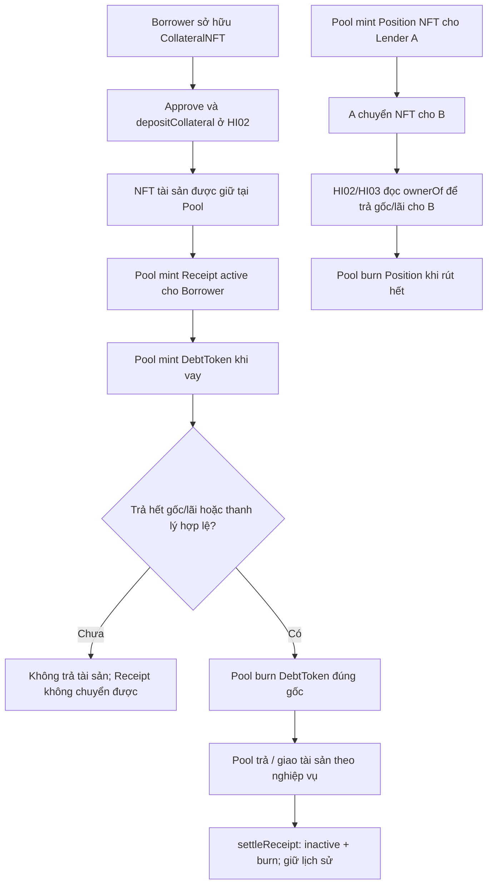

# H02 – Collateral NFT, Receipt, Debt Token & Lending Position (Hùng, Giai đoạn 2)

## 1. Đầu vào và phạm vi bàn giao

H02 nhận đầu vào H01 và các quy tắc/interface đã có trong HI01:

- [MyUSDT và bàn giao H01](h01_myusdt_handoff.md).
- [Đặc tả HI01, mục 4.2 và 6](smart_contract_spec.md).
- [ICollateralNFT](../contracts/interfaces/ICollateralNFT.sol),
  [ICollateralReceiptNFT](../contracts/interfaces/ICollateralReceiptNFT.sol),
  [IDebtToken](../contracts/interfaces/IDebtToken.sol),
  [ILendingPositionNFT](../contracts/interfaces/ILendingPositionNFT.sol).

Theo kế hoạch, HI02 nhận đầu ra H02 để xây dựng LendingPool. Repo hiện chưa có
implementation `contracts/LendingPool.sol`. H02 cung cấp token, ABI, địa chỉ local
và unit test; không tạo Pool thay cho Hiếu hoặc tự xác nhận các kiểm thử tài chính
cần Pool thật. Contract `H02TokenCaller` chỉ là bộ gọi thử trong thư mục mocks,
không được deploy hoặc ghi vào registry production.

## 2. Bốn contract

| Contract | Vai trò | Mint / burn | Chuyển nhượng |
|---|---|---|---|
| `CollateralNFT` | ERC721URIStorage, tài sản gốc, valuation theo MyUSDT WAD | Owner mint; owner cập nhật valuation | ERC-721 chuẩn, Pool giữ NFT khi thế chấp |
| `CollateralReceiptNFT` | Biên nhận quyền giữ tài sản, phân biệt tài sản gốc | Chỉ Pool mint/settle | Không chuyển nhượng |
| `DebtToken` | ERC-20, 18 decimals, phản ánh **gốc nợ** | Chỉ Pool mint/burn | transfer và transferFrom luôn revert |
| `LendingPositionNFT` | Định danh vị thế có quyền hưởng gốc/lãi | Chỉ Pool mint/burn | transferFrom / safeTransferFrom chuẩn |

### CollateralNFT

`mintCollateral(to, valuationWad, uri)` chỉ owner gọi; valuation khởi tạo > 0,
URI không rỗng. ID bắt đầu từ 1 và tăng đơn điệu. Không bắt buộc dữ liệu IPFS H03
để viết/test H02; URI trong unit test được ghi rõ là fixture.
`valuation(tokenId)` trả đơn vị `1 MyUSDT = 1e18`; token không tồn tại thì revert.
`setValuation` chỉ owner gọi; cho phép 0 để biểu diễn tài sản mất hết giá trị.
URI được cố định khi mint. Hợp đồng hỗ trợ ERC165, ERC721, metadata và ERC4906.

Khóa tài sản bằng custody ERC-721: Borrower approve rồi Pool chuyển NFT vào Pool.
Approval theo token bị xóa sau transfer; chủ cũ, operator cũ và owner quản trị
không thể tự chuyển NFT đang thuộc Pool. Pool thật cần hỗ trợ IERC721Receiver
khi dùng safeTransferFrom, và kiểm tra dư nợ trước khi trả tài sản theo HI01.
CollateralNFT không tự đọc dư nợ hoặc thay thế quy tắc rút của HI02/HI03.

### CollateralReceiptNFT

`mintReceipt(borrower, isNFT, assetIdOrAmount)` chỉ Pool gọi. Token collateral
phải có amount > 0; NFT tokenId 0 vẫn hợp lệ theo ERC-721.
Mỗi Borrower có tối đa một receipt active, theo mô hình một vị thế thế chấp HI01.
Thông tin receipt và `activeReceiptOf` được khởi tạo trước callback safe mint.

Owner receipt hoặc operator đã approve vẫn không thể chuyển biên nhận.
`settleReceipt(id, liquidated)` chỉ Pool gọi, đánh dấu inactive, xóa activeReceiptOf
và burn NFT. `getReceiptInfo(id)` vẫn đọc được lịch sử sau burn; `ownerOf` sẽ revert.
Settlement lặp hoặc ID không tồn tại bị từ chối. Có thể mint receipt mới sau tất toán.
Pool phải kiểm tra điều kiện trả nợ/thanh lý trước khi gọi settleReceipt.

### DebtToken

Tổng cung ban đầu 0, decimals 18. `mint`/`burn` yêu cầu amount > 0.
Khi vay, Pool mint đúng số gốc; trả một phần gốc thì burn phần tương ứng.
Lãi do LendingPool/HI04 tính, không được mint thêm DebtToken cho lãi.
Approve không giúp chuyển nợ: cả transfer và transferFrom đều revert,
kể cả amount = 0 hoặc allowance vô hạn. Không có hàm faucet/admin mint.

### LendingPositionNFT

`mintPosition(lender, amountWad)` chỉ Pool gọi, amount > 0, ID từ 1.
Sự kiện PositionMinted ghi gốc ban đầu; số dư gốc/lãi hiện tại nằm trong Pool.
Chuyển A → B thay đổi ownerOf và xóa approval cũ.
HI02/HI03 phải kiểm tra ownerOf **tại thời điểm rút**, chi trả cho chủ hiện tại.
`burnPosition` chỉ Pool gọi, sự kiện PositionBurned ghi đúng chủ hiện tại,
không phải người gửi tiền ban đầu. Token không cung cấp đường mint/burn cho admin.

## 3. Cấu hình Pool một lần sau HI02

Ba contract DebtToken/Receipt/Position kế thừa `PoolControlled`:

- Owner cấu hình ban đầu là deployer.
- `lendingPool()` ban đầu là address zero; các ví thông thường chưa thể mint/burn.
- `setLendingPool(poolAddress)` chỉ owner, poolAddress phải khác 0 và có code.
- Chỉ cấu hình được **một lần**; owner cũng không được đổi sang Pool khác sau đó.
- Owner không có quyền mint/burn thay Pool. Không renounce ownership trước khi bind.

Trình tự tích hợp để tránh phụ thuộc vòng:

1. Deploy các token H02 trước; đọc địa chỉ từ manifest/registry.
2. Hiếu deploy LendingPool thật với các địa chỉ token/interface tương ứng.
3. Sau khi Pool deploy xong, owner của từng token bind cùng một Pool:
```javascript
for (const name of ["DebtToken", "CollateralReceiptNFT", "LendingPositionNFT"]) {
  const token = await ethers.getContractAt(name, tokenAddressByName[name], tokenOwner);
  await (await token.setLendingPool(poolAddress)).wait();
  if ((await token.lendingPool()) !== poolAddress) throw new Error("Pool binding mismatch");
}
```
4. Kiểm tra getters của Pool trỏ đúng token, cập nhật trạng thái deployment rồi chạy test HI02.
   Pool constructor không được mint token trước bước bind.

Script H02 không điền địa chỉ Pool giả, không bind vào EOA hoặc test caller.
Nhận xét `onlyPool` bảo đảm **ai gọi**; việc gọi đúng thời điểm, đúng số gốc,
đủ thanh khoản, đủ LTV và mở khóa khi nợ = 0 thuộc nghiệp vụ Pool của HI02/HI03.

## 4. Công cụ và cách chạy

Solidity 0.8.24, optimizer 200 runs, EVM Paris được giữ theo Q01.
OpenZeppelin được cố định **5.0.2**: bản 5.6.1 trước đó đưa `mcopy` qua
ERC721 → Strings → Bytes, không biên dịch được cho Paris.
H01/HI01 đã được kiểm thử lại. Các dependency khác và package tùy chọn
cho các hệ điều hành khác trong lockfile được giữ lại.

```powershell
npm ci
npm run compile
npm run test:h02
npm test
npm run export:h02
```

Export tạo 4 artifact implementation trong `deployments/abi/` và 4 artifact
interface trong `deployments/abi/interfaces/`. Mỗi JSON có `abi`; artifact
implementation có `bytecode`/`deployedBytecode`. Interface có bytecode rỗng vì
không phải contract triển khai được.

Local:
```powershell
# Terminal 1
npm run node
# Terminal 2, deploy/seed H01 trên node hiện tại rồi deploy H02
npm run deploy:myusdt
npm run deploy:h02
npm run verify:h02
```

`deploy:h02` chỉ chạy localhost và xác minh Chain ID / H01 có code / decimals 18.
Nếu đã có LendingPool trong registry thì dừng, để tránh thay token ngoài ý muốn
khi một Pool đang hoạt động. Nếu node restart, phải deploy lại.
MyUSDT đã được redeploy/export trên node mới để bytecode khớp OpenZeppelin đã pin.

## 5. File bàn giao

- [Manifest local](../deployments/localhost.json): address, txHash, blockNumber,
  owner, abiPath và trạng thái.
- [Registry backend](../backend/config/contracts.json): cập nhật 4 mục token H02;
  không đăng ký test caller và không sửa các địa chỉ Sepolia/PriceOracle/LendingPool.
- [ABI implementations](../deployments/abi/CollateralNFT.json) và
  [interfaces](../deployments/abi/interfaces/ICollateralNFT.json).
- [Kiểm tra deployment local](../reports/h02_local_verification.json).
- [Log kiểm thử và phần chờ tích hợp](../reports/h02_token_validation.md).

CollateralNFT ở trạng thái DEPLOYED; ba token còn lại là AWAITING_HI02_POOL,
lendingPool = address zero. Các địa chỉ/txHash này là bằng chứng local.

## 6. Vòng đời biên nhận và vị thế



Unit test H02 xác nhận token custody, quyền gọi và chuyển ownership.
Thực hiện depositCollateral/borrow/repay/withdraw và kiểm tra số tiền
gốc+lãi được trả đúng chủ sau chuyển NFT cần implementation HI02/HI03.

## 7. Tham khảo triển khai

- [OpenZeppelin ERC721](https://docs.openzeppelin.com/contracts/5.x/api/token/erc721)
- [OpenZeppelin extending contracts](https://docs.openzeppelin.com/contracts/5.x/extending-contracts)
