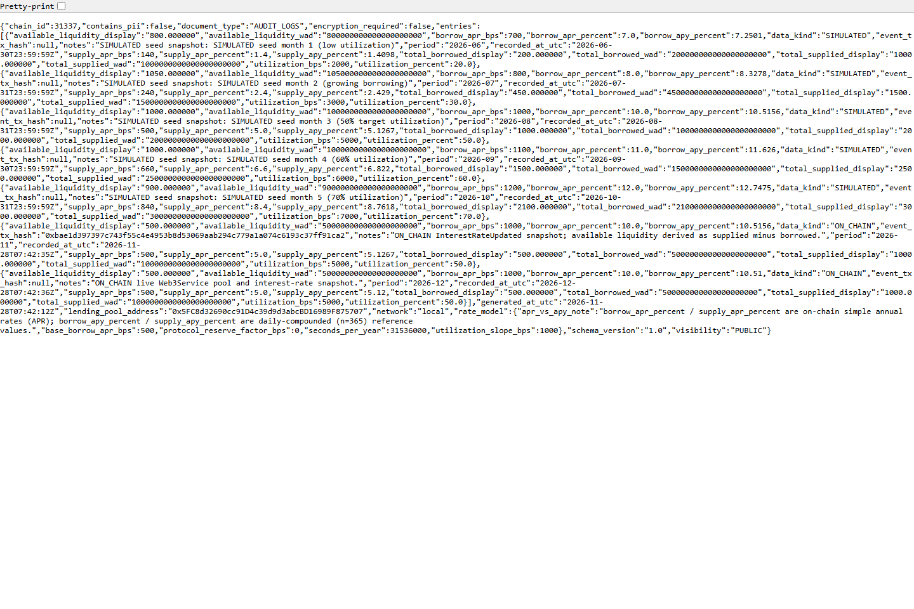
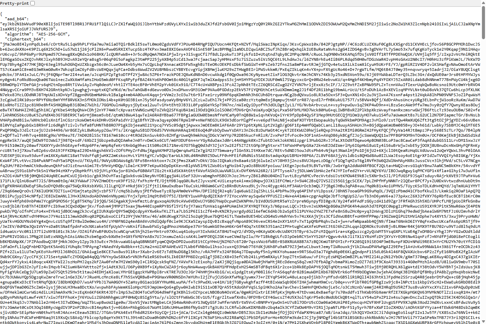

# Q03 & Q04 — Báo cáo kiểm chứng End-to-End Loan Agreement PDF, Credit Report & Audit Logs (Live Pin IPFS Kubo & RBAC)

- **Thời điểm thực thi (UTC):** `2026-11-28T07:42:06Z`
- **Hạ tầng Blockchain:** Hardhat Local node thực (`chainId = 31337`).
- **Hạ tầng IPFS thật:** **IPFS Kubo `v0.43.2`** (`PeerID = 12D3KooWFjaQAjmQAVzaBx2cNB6Gv65GwZTnuT6VkJ6siE5C1xEP`, API `http://127.0.0.1:5001`, HTTP Gateway `http://127.0.0.1:8088/ipfs`), chạy ở chế độ nghiêm ngặt **`provider = "kubo"`, `enable_local_fallback = False`** (không dùng local store giả lập).
- **Bảo mật khóa:** Dùng khóa ngẫu nhiên 32-byte mới tạo trong `.env` cục bộ (`DOCUMENT_AES_KEY_HEX` và `AUTH_TOKEN_SECRET`, không dùng chuỗi mẫu cố định).
- **Kịch bản tài sản thế chấp:** Áp dụng đúng **Phương án A (`CollateralNFT`, `isNFT = true`)** — Borrower A thế chấp `CollateralNFT #2` (định giá `1,000 MyUSDT`) để vay `500 MyUSDT` (`LTV = 50% <= 70%`).

## 1. Luồng End-to-End thật trên Hardhat (31337) + Live Pin IPFS Kubo

| Bước | Hành động / Endpoint | Bằng chứng thực tế |
|---|---|---|
| 1 | `APPROVE_COLLATERAL_NFT` (`tokenId = 2`) | txHash `0x6a6d16220a2bc16865d4832e29345266ef467f2a44e323e49a5a43c131c7916f` (Block `25`, gas `48,691`) |
| 2 | `DEPOSIT_COLLATERAL` (`is_nft = true`, `tokenId = 2`) | txHash `0x0e1fb699d1ba44318b78951f6f6eb471db027876d499468a8a52da07faae6fef` (Block `26`, gas `412,239`) |
| 3 | `POST /api/ipfs/create-agreement` (trước khi vay, `PRIVATE`) | `provider_used = "kubo"`, `status = PRE_BORROW_UNSIGNED`, `tx_hash = null`, CID `bafkreifuusixoxgfab5n3ug33xg4ohy6joe7cgo7flqht3zr7r3rzohcri`, `SHA-256 = 44c42fa7516325eb1041c7e2ef06aa6683ad9d98c122b86cfd20467f052985dd`. Mở trực tiếp Gateway `http://127.0.0.1:8088/ipfs/bafkreifuusixoxgfab5n3ug33xg4ohy6joe7cgo7flqht3zr7r3rzohcri` trả `HTTP 200` dạng JSON mã hóa `AES-256-GCM` (không chứa `%PDF-`). |
| 4 | `BORROW` (`500 MyUSDT`, gắn `agreementCid`) & `POST /api/transactions/confirm` | txHash `0xbae1d397397c743f55c4e4953b8d53069aab294c779a1a074c6193c37ff91ca2` (Block `27`, gas `344,868`). Lưu `LoanTxBindingRecord` khớp `agreement_cid` và `tx_hash` chỉ sau khi xác minh receipt `status == 1` + event `LoanBorrowed`. |
| 5 | `POST /api/demo/time` (`+30 ngày`) + `TRANSFER_LENDING_POSITION_NFT` (`#1`) | Tua 30 ngày sinh lãi on-chain; chuyển `LendingPositionNFT #1` sang Lender B (`0x778b00d535dca63b911bbf7937693ed072342314ff9efe151fc4e8a04b272ff9`, Block `29`, gas `57,902`). |
| 6 | `POST /api/ipfs/credit-report/{Borrower A}` (`PRIVATE`) | `provider_used = "kubo"`, CID `bafkreihnv6iem7rj7xfdrd7ucdquq7wty74tlamn4ux6xsghcnlpylbzje`, `SHA-256 = 4fb82129a52da2433d4f9f45098407ebb5006ab5b0c4d9f6fa40ecd0297be9b8`, `credit_score = 540` (`POOR`, 1 khoản vay active). Mở Gateway trả `HTTP 200` bản mã `AES-256-GCM`, không chứa địa chỉ ví bản rõ. |
| 7 | `POST /api/ipfs/audit-logs` (Admin, `PUBLIC`) | `provider_used = "kubo"`. JSON CID `bafkreiev3cjq3fzisl2uayrhgzw6a2wjsvqjkof56khblscrqmnhkf57wq` (`SHA-256 = 95d8930d972892f5406227366de06ac995609538bdf28e15c851831a7517bfb4`); CSV CID `bafkreigdzv5qbfkoujrumqrlhydpcaakkchcbsu5qifnk4pqbzukfn46ca` (`SHA-256 = c3cd7b00954ea26346422b3e06f1000a508e20ca9d820ad571f00e68a2b79e10`). Mở trực tiếp cả 2 URL trên Kubo Gateway đều `HTTP 200` và khớp SHA-256. |
| 8 | Xác minh `ipfs pin ls --type=recursive` | Cả `4/4` CID (Loan Agreement, Credit Report, Audit Logs JSON, Audit Logs CSV) đều hiện diện trong danh sách pin đệ quy của Kubo. |

## 2. Kết quả ma trận phân quyền RBAC & toàn vẹn SHA-256 (qua Kubo thật, tắt fallback)

| Tài liệu | Visibility | Guest | Lender | Borrower khác | Owner | Admin | Toàn vẹn SHA-256 |
|---|---|---|---|---|---|---|---|
| **Loan Agreement PDF** | `PRIVATE` | `401` | `403` | `403` | `200` | `200` | Khớp `X-Content-SHA256` & `%PDF-` |
| **Credit Report JSON** | `PRIVATE` | `401` | `403` | `403` | `200` | `200` | Khớp `X-Content-SHA256` |
| **Audit Logs JSON** | `PUBLIC` | `200` | — | — | — | — | Khớp `X-Content-SHA256` & Gateway |
| **Audit Logs CSV** | `PUBLIC` | `200` | — | — | — | — | Khớp `X-Content-SHA256` & Gateway |

## 3. Ảnh minh chứng mở trực tiếp trên Kubo Gateway thật

- **Audit Logs JSON công khai (`PUBLIC`, không PII, tách rõ `SIMULATED` và `ON_CHAIN`):**
  
- **Loan Agreement PDF riêng tư (`PRIVATE`, bản mã `AES-256-GCM` trên Gateway, không lộ `%PDF-`):**
  
