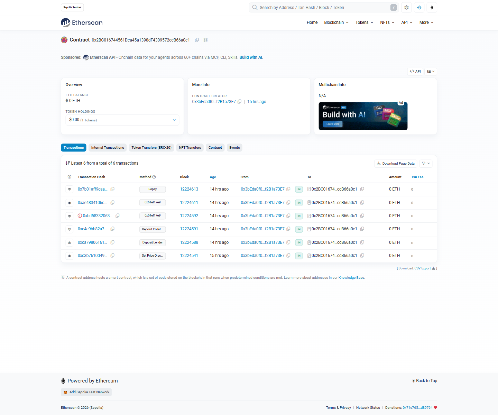
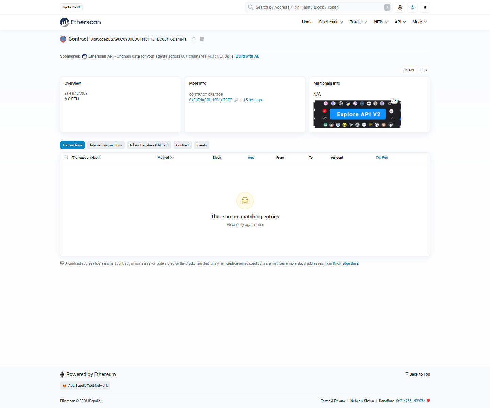
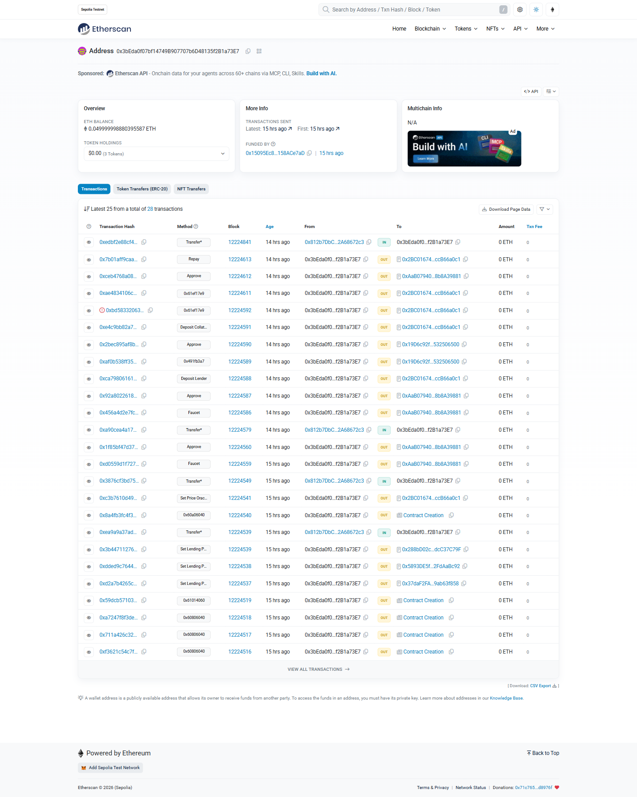
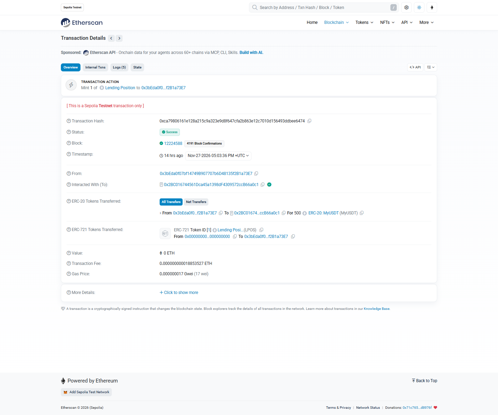
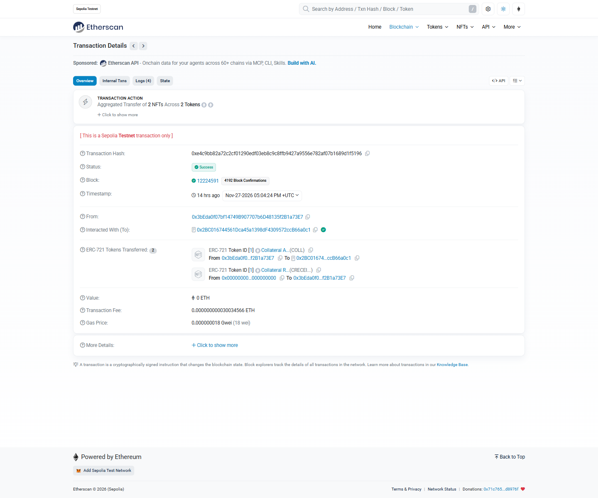
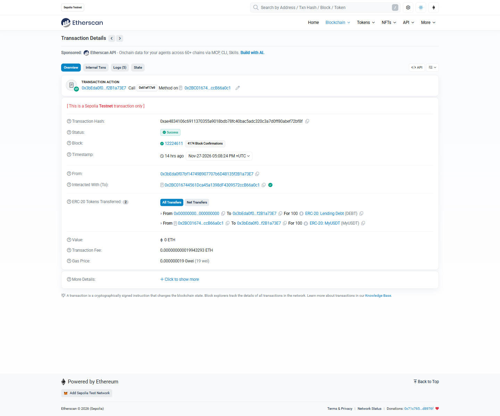
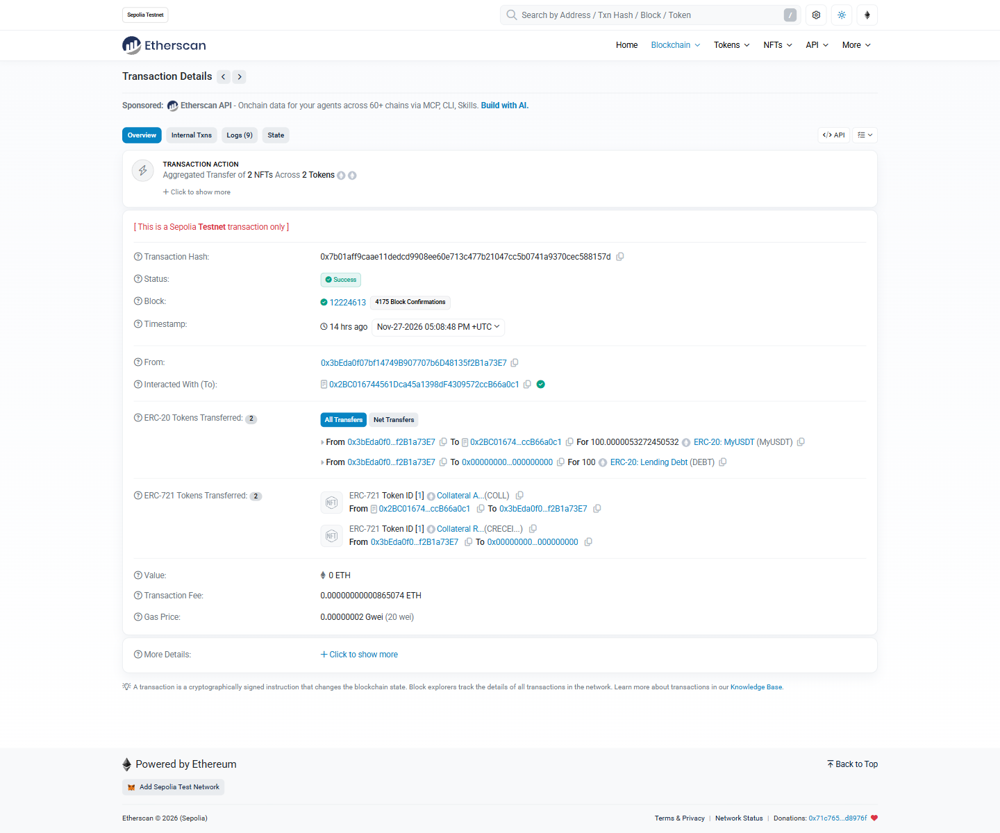

# Q06 — Báo cáo kiểm chứng One-Click Local Reset, Live Pin Kubo, Dual-Network Config & Sepolia Testnet

- **Thời điểm thực thi (UTC):** `2026-11-28T07:42:06Z`
- **Module kiểm tra:** `scripts/deploy_utils.py`, `scripts/deploy_and_seed.py`, `scripts/deploy_sepolia.py`, `scripts/start_all.bat`, `scripts/start_all.sh`, `deployments/localhost.json`, `deployments/sepolia.json`, `backend/config/contracts.json`, `frontend/src/config/contracts.json`

## 1. Các lỗi còn sót của Q06 đã xử lý

1. **`scripts/deploy_and_seed.py`:** Đã bỏ đoạn ép cứng `provider="local_fallback"` và xóa `pinata_jwt`/`pinata_api_key`/`pinata_secret_api_key`; nay dùng trực tiếp `IPFSConfig.from_env()` và ghi trường `providerUsed` vào `deployments/localhost.json`.
2. **`scripts/start_all.sh`:** Đã cập nhật đồng bộ với `scripts/start_all.bat` — ưu tiên `.venv/bin/python` (hoặc `.venv/Scripts/python.exe`), tự kiểm tra & khởi chạy nền `ipfs daemon` (có dừng gọn trong `cleanup()`), và chỉ fallback sang `IPFS_PROVIDER=local_fallback` khi Kubo không khả dụng.
3. **Cấu trúc đa mạng cho `frontend/src/config/contracts.json`:** `scripts/deploy_utils.py` nay xuất đồng thời cả top-level (`network`, `chainId`, `explorerUrl`, `contracts` kèm `abi` để tương thích ngược) lẫn `networks.local` và `networks.sepolia`, giúp không bị ghi đè mất địa chỉ mạng còn lại khi redeploy.

## 2. Đo thời gian khôi phục sạch Local Hardhat + Live Pin Kubo (`<= 30 giây`)

Chạy trực tiếp trên node Hardhat mới (`chainId = 31337`) cùng **IPFS Kubo `v0.43.2` daemon** (`PeerID = 12D3KooWFjaQAjmQAVzaBx2cNB6Gv65GwZTnuT6VkJ6siE5C1xEP`, API `5001`, Gateway `8088`):

- Khởi động Hardhat node + Kubo daemon đến khi sẵn sàng: **`2.71 giây`**
- Chạy `deploy_and_seed.run_local_deployment()` (deploy 7 contract + bind + faucet 9 ví + mint `CollateralNFT #1/#2` + nạp `1,000 MyUSDT` + **Live Pin Q04 Audit Logs JSON/CSV lên Kubo thật** + sync 3 manifest): **`1.83 giây`**
- **Tổng thời gian khôi phục sạch:** **`4.54 giây`** (vượt xa mục tiêu `<= 30 giây`).
- Xác minh Live Pin Kubo trong `deployments/localhost.json`:
  - `auditLogs.providerUsed`: **`"kubo"`**
  - `auditLogs.json.cid`: `bafkreiebh4wwlc4owodhuhgx7p5tt7jhe57ptwmawicqtanvhe27wg57nq` (`HTTP 200` qua Kubo Gateway `http://127.0.0.1:8088/ipfs/...`, khớp SHA-256)
  - `auditLogs.csv.cid`: `bafkreiaqrsumm3rffawbca5kckl4y5nz7v6my4bz2rk7vy5auqvusyqywy` (`HTTP 200` qua Kubo Gateway `http://127.0.0.1:8088/ipfs/...`, khớp SHA-256)
- Xác minh `frontend/src/config/contracts.json`: `network = "local"`, `chainId = 31337`, đồng thời giữ đủ cả 2 mạng `networks.local` (`31337`, 7/7 contract) và `networks.sepolia` (`11155111`, 7/7 contract).

## 3. Kiểm chứng trực tiếp 7/7 hợp đồng & Smoke-Test trên Ethereum Sepolia (`11155111`)

Truy vấn trực tiếp RPC Sepolia tại block `12228616` (`eth_getCode` + `eth_getTransactionReceipt`):

| Contract | Địa chỉ Sepolia | Kích thước Bytecode | Trạng thái | Etherscan |
|---|---|---:|---|---|
| `MyUSDT` | `0xAaB07940F52BB7C105D17681f896E648b8A39881` | 2,430 bytes | `LIVE` | https://sepolia.etherscan.io/address/0xAaB07940F52BB7C105D17681f896E648b8A39881 |
| `CollateralNFT` | `0x19D6c92fd592f5B077189D4300a8737532506500` | 5,716 bytes | `LIVE` | https://sepolia.etherscan.io/address/0x19D6c92fd592f5B077189D4300a8737532506500 |
| `CollateralReceiptNFT` | `0x37daF2FA967b3A72024Ad7ED0BBCe889ab63f858` | 5,983 bytes | `LIVE` | https://sepolia.etherscan.io/address/0x37daF2FA967b3A72024Ad7ED0BBCe889ab63f858 |
| `DebtToken` | `0x5893DE5fe88057dBdE28672C9d85Dcf2FdAaBc92` | 2,747 bytes | `LIVE` | https://sepolia.etherscan.io/address/0x5893DE5fe88057dBdE28672C9d85Dcf2FdAaBc92 |
| `LendingPositionNFT` | `0x288bD02c150b2eEC0FCB82331791AB2dcC37C79F` | 5,049 bytes | `LIVE` | https://sepolia.etherscan.io/address/0x288bD02c150b2eEC0FCB82331791AB2dcC37C79F |
| `LendingPool` | `0x2BC016744561Dca45a1398dF4309572ccB66a0c1` | 14,752 bytes | `LIVE` | https://sepolia.etherscan.io/address/0x2BC016744561Dca45a1398dF4309572ccB66a0c1 |
| `PriceOracle` | `0x85cdeb0BA90C69006D61f13F131BC03f16Da484a` | 2,457 bytes | `LIVE` | https://sepolia.etherscan.io/address/0x85cdeb0BA90C69006D61f13F131BC03f16Da484a |

### Smoke-test Receipts xác minh live trên Sepolia (nhánh `CollateralNFT`)

| Hành động | txHash | Block | Gas Used | Status | Etherscan |
|---|---|---:|---:|---:|---|
| `depositLender` | `0xca79806161e128a215c9a323e9d8f647cfa2b863e12c7010d156493ddbee6474` | `12224588` | `1,109,031` | `1` | https://sepolia.etherscan.io/tx/0xca79806161e128a215c9a323e9d8f647cfa2b863e12c7010d156493ddbee6474 |
| `depositCollateral` | `0xe4c9bb82a72c2cf01290edf03eb8c9c8ffb9427a9556e782af07b1689d1f5196` | `12224591` | `1,668,587` | `1` | https://sepolia.etherscan.io/tx/0xe4c9bb82a72c2cf01290edf03eb8c9c8ffb9427a9556e782af07b1689d1f5196 |
| `borrow` | `0xae4834106c6911370355a9018bdb78fc40bac5adc320c3a7d0ff80abef72bf8f` | `12224611` | `1,049,647` | `1` | https://sepolia.etherscan.io/tx/0xae4834106c6911370355a9018bdb78fc40bac5adc320c3a7d0ff80abef72bf8f |
| `repay` | `0x7b01aff9caae11dedcd9908ee60e713c477b21047cc5b0741a9370cec588157d` | `12224613` | `432,537` | `1` | https://sepolia.etherscan.io/tx/0x7b01aff9caae11dedcd9908ee60e713c477b21047cc5b0741a9370cec588157d |

### Ảnh chụp màn hình trình duyệt Sepolia Etherscan (TC1 & TC4 — đã chụp đủ 7/7)

1. **Hợp đồng `LendingPool` (`0x2BC016744561Dca45a1398dF4309572ccB66a0c1`):**
   
2. **Hợp đồng `PriceOracle` (`0x85cdeb0BA90C69006D61f13F131BC03f16Da484a`):**
   
3. **Ví Deployer (`0x3bEda0f07bf14749B907707b6D48135f2B1a73E7` — đầy đủ 7 contract creation + bind + smoke txs):**
   
4. **Giao dịch `depositLender` (`Success`, Block `12224588`, nạp `500 MyUSDT`, mint `LPOS #1`):**
   
5. **Giao dịch `depositCollateral` (`Success`, Block `12224591`, khóa `COLL #1`, mint `CRECEIPT #1`):**
   
6. **Giao dịch `borrow` (`Success`, Block `12224611`, vay `100 MyUSDT`, mint `100 DEBT`):**
   
7. **Giao dịch `repay` (`Success`, Block `12224613`, trả gốc + lãi `100.000005... MyUSDT`, burn `DEBT` & `CRECEIPT #1`, hoàn trả `COLL #1`):**
   
